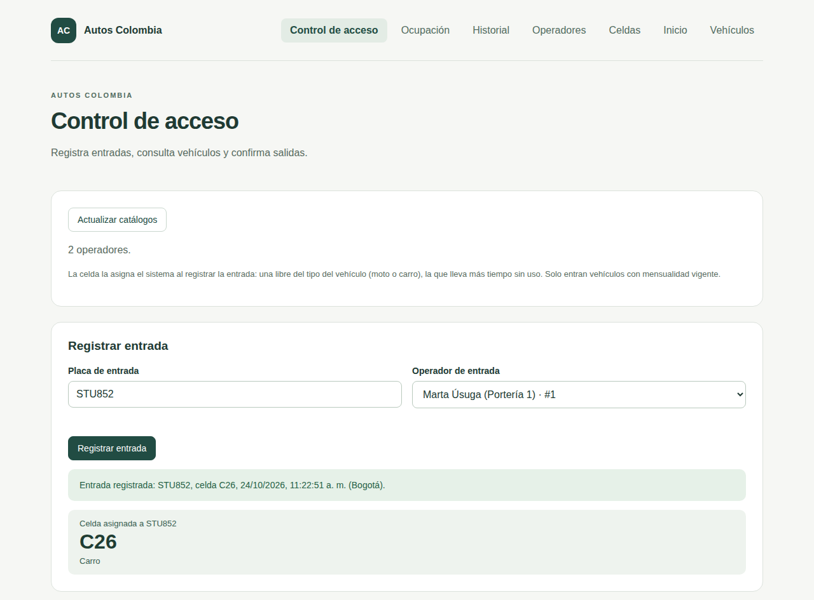
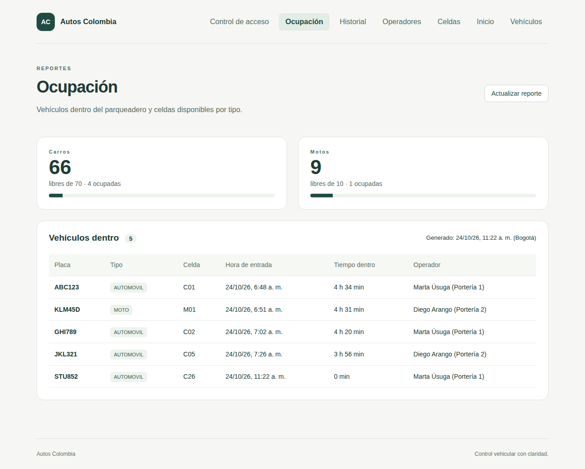
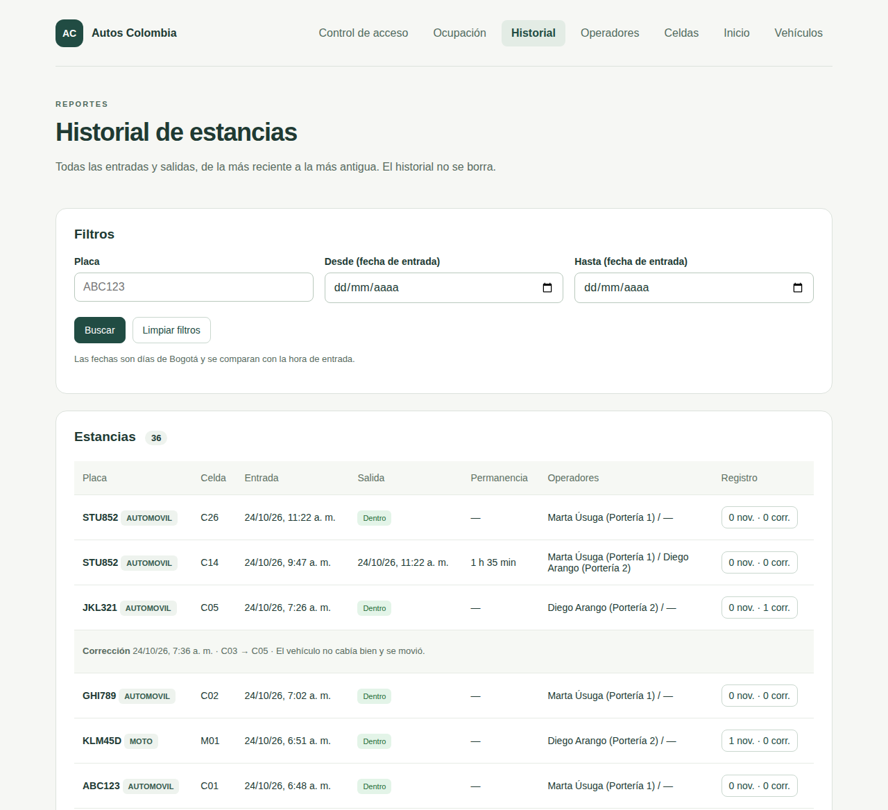
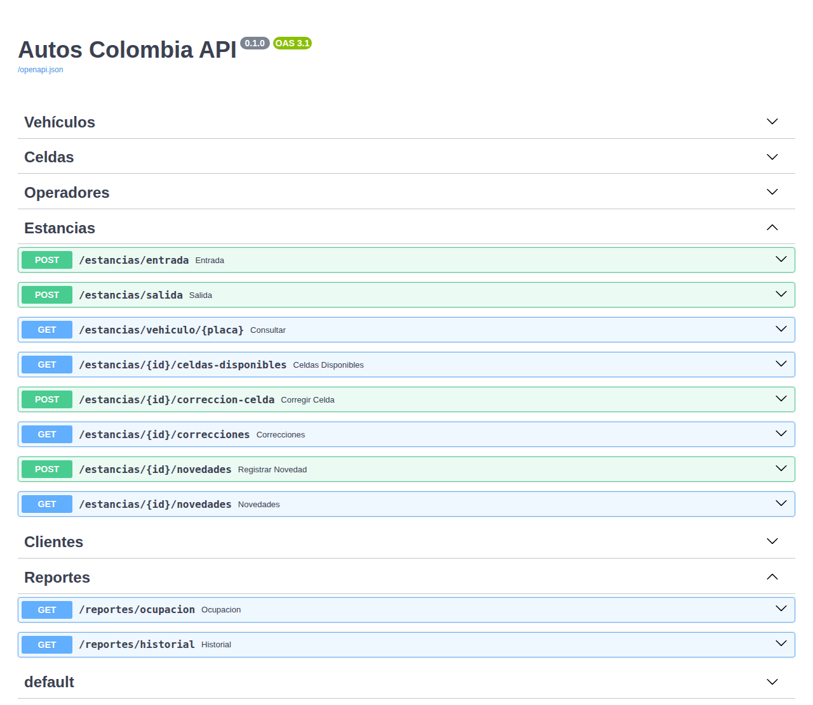

# Autos Colombia — EA1, Iteración 1: entrada y salida de vehículos

Proyecto del curso **Ingeniería de Software (IU Digital)**. Sistema para el parqueadero
"Autos Colombia": clientes con mensualidad por vehículo, entrada con asignación automática
de celda, salida con tiempo de permanencia, corrección de celda, novedades, reporte de
ocupación e historial. Desde la Iteración 2: ingreso con roles y gestión de cuentas y celdas.
Desde la Iteración 3: tarifas, registro de clientes y pagos de mensualidad con resumen,
comprobante, anulación y resumen de recaudo.

- **Backend:** Python 3.12 · FastAPI · SQLAlchemy · Alembic · PostgreSQL 17.
- **Frontend:** Angular 22 · TypeScript, servido por nginx.
- **Todo se levanta con un solo comando** usando Docker Compose.

> **Basado en el proyecto del profesor Reinaldo Rojas**
> (<https://github.com/ReinaldoRojas/AutosColombia>). Ver [Crédito](#crédito-qué-viene-del-profesor-y-qué-agregamos).

## Contenido

1. [Inicio rápido](#inicio-rápido)
2. [Capturas](#capturas)
3. [Guion de demostración (HU-01 a HU-14)](#guion-de-demostración-hu-01-a-hu-14)
4. [Guion de demostración de la Iteración 2 (HU-15 a HU-25)](#guion-de-demostración-de-la-iteración-2-hu-15-a-hu-25)
5. [Guion de demostración de la Iteración 3 (HU-26 a HU-33)](#guion-de-demostración-de-la-iteración-3-hu-26-a-hu-33)
6. [Verificación de requerimientos no funcionales](#verificación-de-requerimientos-no-funcionales)
7. [Reglas implementadas](#reglas-implementadas)
8. [API](#api)
9. [Datos de demostración](#datos-de-demostración)
10. [Pruebas](#pruebas)
11. [Arquitectura y estructura](#arquitectura-y-estructura)
12. [Instalación sin Docker](#instalación-sin-docker)
13. [Crédito: qué viene del profesor y qué agregamos](#crédito-qué-viene-del-profesor-y-qué-agregamos)
14. [Decisiones y supuestos](#decisiones-y-supuestos)

## Inicio rápido

Requisitos: Docker 29 y Docker Compose v5 (verificado en Ubuntu con 29.9 / v5.6).

```bash
git clone https://github.com/HannaSalinas/autos-colombia-ea1.git
cd autos-colombia-ea1
cp .env.example .env      # credenciales (cambia en .env las contraseñas y JWT_SECRETO)
docker compose up --build
```

**Antes de levantar el sistema hay que copiar `.env.example` a `.env`.** El usuario y la
contraseña de PostgreSQL no están en el repositorio: Docker Compose los lee de `.env`, que
git ignora. `.env.example` solo trae valores de ejemplo. Si falta `.env`, Compose se detiene
con el mensaje "Falta .env. Ejecuta: cp .env.example .env". Si cambias la contraseña cuando
la base ya existe, recréala con `docker compose down -v`, porque PostgreSQL guarda la
contraseña al crear la base.

Desde la Iteración 2, `.env` también lleva la clave que firma los tokens de sesión
(`JWT_SECRETO`, 32 caracteres o más) y las contraseñas de las cuentas semilla
(`ADMIN_USUARIO`, `ADMIN_NOMBRE`, `ADMIN_CONTRASENA`, `MARTA_CONTRASENA`,
`DIEGO_CONTRASENA`). Las contraseñas deben tener de 8 a 64 caracteres, con al menos una letra
y un número. Si falta alguna, Compose se detiene y dice cuál. Las cuentas se crean la primera
vez que arranca el sistema; si después cambias una contraseña en `.env`, no se actualiza
(recrea la base con `docker compose down -v`).

Estas direcciones funcionan en tu equipo después de levantar el sistema con `docker compose up`:

| Qué | Dirección |
| --- | --- |
| Aplicación | `http://localhost:4200` |
| Documentación interactiva de la API | `http://localhost:8000/docs` |
| Salud de la API | `http://localhost:8000/health` |

Al arrancar, el backend aplica las migraciones (`alembic upgrade head`) y carga las
**semillas** (`python -m app.seed`): 80 celdas, 2 operadores, 6 clientes, 9 vehículos y sus
mensualidades. Las semillas no se duplican si se reinicia.

```bash
docker compose up --build -d                    # en segundo plano
docker compose logs -f backend                  # registro del backend
docker compose exec backend python -m app.demo  # (opcional) historial de 7 días para capturas
docker compose down                             # detener (conserva los datos)
docker compose down -v                          # detener y BORRAR la base (vuelve a quedar limpia al levantar)
```

## Capturas

Tomadas del sistema con los [datos de demostración](#datos-de-demostración) cargados. Todos
los nombres, placas y documentos son ficticios.

**Control de acceso:** entrada registrada con la celda que asignó el sistema.



**Ocupación:** celdas libres por tipo y vehículos dentro.



**Historial:** estancias con permanencia, operadores y el detalle de novedades y correcciones.



**Documentación de la API** (`/docs`, generada por FastAPI).



## Guion de demostración (HU-01 a HU-14)

Empieza con la **base limpia** (solo semillas), para que las celdas asignadas coincidan
con las de este guion:

```bash
docker compose down -v && docker compose up --build -d
```

Los dos operadores son **Marta Úsuga (Portería 1)** y **Diego Arango (Portería 2)**.
**Iteración 2:** el sistema pide ingresar. Marta entra con `marta.usuga`, Diego con
`diego.arango` y el Administrador con `ADMIN_USUARIO` (por defecto `admin`); las contraseñas
están en tu `.env`. Los pasos de **Vehículos** (HU-14 y HU-03) se hacen con la cuenta del
Administrador, porque el Operador solo consulta ese listado. En los pasos de portería, "con
Marta" o "con Diego" significa con la sesión de esa cuenta: el responsable ya no se elige.
Las fechas se muestran en hora de Bogotá y las asigna el servidor. Los pasos siguen el
orden de una demostración real: primero se registra un vehículo, luego entra, se consulta,
se corrige y sale. Cada paso lleva el número de su historia de usuario. Los requerimientos
no funcionales se verifican al final, en
[Verificación de requerimientos no funcionales](#verificación-de-requerimientos-no-funcionales).

### HU-14 · Registrar vehículo con propietario

1. En **Vehículos → Nuevo vehículo** registra: placa `qwe-456`, marca Kia, modelo 2024,
   color Gris, tipo AUTOMOVIL y cliente **Paola Ríos**. Se guarda como `QWE456`.
2. Sin cliente no deja guardar ("Selecciona el cliente").
3. El selector de tipo solo ofrece MOTO, AUTOMOVIL y CAMIONETA. En `/docs`,
   `POST /vehiculos` con `"tipo": "CAMION"` responde **422**.
4. Modelo `1899` o el año actual + 2: error de año. El rango válido va de 1900 al año
   actual + 1.
5. En `/docs`, `GET /clientes` y luego `GET /clientes/{id}/vehiculos` de Paola Ríos: ahora
   tiene dos vehículos (MNO654 y QWE456). Un cliente puede tener varios vehículos.

### HU-03 · Validar formato de placa

En **Vehículos → Nuevo vehículo**:

| Datos | Resultado |
| --- | --- |
| Placa `ABC12D`, tipo AUTOMOVIL | Error: la placa de carro es 3 letras y 3 números |
| Placa `ZZZ111`, tipo MOTO | Error: la placa de moto es 3 letras, 2 números y 1 letra |
| Placa ` xyz-98 a `, tipo MOTO, modelo del año actual + 1 | Se guarda como `XYZ98A` |

La misma regla se valida en el navegador, en la API (422) y en PostgreSQL (CHECK). En
Control de acceso la placa también se normaliza: `abc-123` se busca como `ABC123` (se ve
en HU-02).

### HU-01 · Identificar operador

**Iteración 2:** el operador se identifica al ingresar con su cuenta (HU-15) y ya no se
elige en un selector (HU-18).

1. Cierra sesión e ingresa con `marta.usuga`. Abre **Control de acceso**: el panel superior
   dice "Responsable de las operaciones: **Marta Úsuga (Portería 1)**" y no hay selector de
   operador.
2. En `/docs`, `POST /estancias/entrada` con `"operador_id": 2` responde **422**: el
   responsable no se puede enviar, lo pone el servidor con la sesión. Sin token responde
   **401**.
3. Cada movimiento guarda quién lo hizo. Se ve en Ocupación (HU-12) y en el Historial
   (HU-13).

### HU-04 · Validar vehículo registrado y mensualidad vigente

1. En **Vehículos**, la columna *Mensualidad* muestra cada caso:
   - ABC123: "Vigente hasta …".
   - GHI789: vigente hasta **hoy** (vence hoy y todavía puede entrar).
   - DEF456: "Vencida el …".
   - PQR98B: "Empieza el …" (mañana).
   - MNO654: "Sin mensualidad".
2. En **Control de acceso → Registrar entrada**, con Marta Úsuga:
   - `AAA111` (no está registrado): "Vehículo no encontrado.".
   - `DEF456`, `PQR98B` y `MNO654`: "El vehículo no tiene mensualidad vigente. No puede
     ingresar.".
3. Fecha a fecha: en `/docs`, `GET /vehiculos/6/mensualidades` (JKL321) muestra una
   renovación en la que cada periodo termina el mismo día del mes siguiente. Los casos de
   31 de enero → 28/29 de febrero están en `tests/test_reglas.py`.

### HU-02 · Registrar entrada

En **Control de acceso → Registrar entrada** (no hay selector de celda), con Marta Úsuga,
escribe `abc-123` y pulsa *Registrar entrada*. Aparece "Entrada registrada: ABC123, celda
**C01**, …" con la hora del servidor, y una tarjeta con la celda asignada.

### HU-05 · Evitar doble entrada

Vuelve a registrar la entrada de `ABC123`: responde "El vehículo ya está dentro.". Además
de esta validación, la base tiene un índice único que no permite dos estancias abiertas del
mismo vehículo.

### HU-06 · Asignar celda automáticamente

1. Con Marta Úsuga registra las entradas:

   | Placa | Celda asignada |
   | --- | --- |
   | `KLM45D` | **M01** (moto → celda de moto) |
   | `GHI789` | **C02** (carro; su mensualidad vence hoy y todavía entra) |

   Regla: celda libre del tipo del vehículo; primero las nunca usadas y luego la que lleva
   **más tiempo libre**. Esto se comprueba en HU-08.
2. **Dos porterías al mismo tiempo:** abre el sistema en **dos pestañas** y en cada una
   ingresa con una cuenta distinta (la sesión es por pestaña): Marta (Portería 1) en una y
   Diego (Portería 2) en la otra. Abre Control de acceso en ambas. Escribe `JKL321` en las dos y pulsa
   *Registrar entrada* en ambas. Una registra la entrada (celda **C03**) y la otra responde
   "El vehículo ya está dentro.". Nunca se repite celda ni se abren dos entradas.
3. **No hay celdas:** cuando no queda ninguna libre del tipo, la entrada responde "No hay
   celdas disponibles para motos." (o "para carros."). Llenar 70 celdas a mano no es práctico
   en una demostración, así que se prueba con
   `test_concurrencia_una_sola_celda_libre`: dos motos piden la única celda libre a la vez,
   una la recibe y la otra recibe ese mensaje (ver RNF-03).

### HU-11 · Consultar estado de un vehículo

En **Control de acceso → Consultar vehículo**:

| Placa | Resultado |
| --- | --- |
| `ABC123` | "ABC123 · Dentro", marca y color, "Celda C01 · Entrada …" y el botón *Confirmar salida* |
| `DEF456` | "DEF456 · Fuera" |
| `AAA111` | "Vehículo no registrado." |

La mensualidad de cada vehículo se consulta en **Vehículos** (HU-04).

### HU-07 · Registrar salida con tiempo de permanencia

Cierra sesión, ingresa con `diego.arango` (Portería 2), consulta `ABC123` y pulsa
**Confirmar salida**: queda a nombre de Diego. Se muestra en grande el **tiempo de permanencia** (por ejemplo "4 min"), que
calcula el servidor con sus propias horas de entrada y salida.

### HU-08 · Liberar celda

1. Consulta otra vez `ABC123`: ahora aparece "Fuera". En **Ocupación**, C01 ya no está
   ocupada.
2. Registra la entrada de `STU852`. Recibe **C04**, que nunca se ha usado, y no C01, que
   acaba de quedar libre: así se reparte el uso de las celdas.

### HU-09 · Corregir celda

1. Consulta `GHI789` (está en C02). Debajo aparece **Corregir celda**, que solo lista celdas
   libres de carro.
2. Pulsa *Corregir celda* sin motivo: lo pide.
3. Elige **C10**, escribe el motivo "El conductor parqueó en la C10" y pulsa *Corregir celda*.
   La consulta pasa a "Celda C10" y la corrección queda listada (C02 → C10) con fecha y motivo.
4. En `/docs`, `POST /estancias/{id}/correccion-celda` hacia una celda de moto o hacia una
   ocupada responde **409** con el motivo.

### HU-10 · Registrar novedad

Con GHI789 consultado, en **Novedades del vehículo** elige *Rayón*, escribe "Rayón en el
bómper trasero" y pulsa *Registrar novedad*. Aparece en la lista con fecha y hora.

### HU-12 · Ver reporte de ocupación

**Ocupación** muestra 4 vehículos dentro (KLM45D en M01, GHI789 en C10, JKL321 en C03 y
STU852 en C04) con hora de entrada, tiempo dentro y operador. Arriba aparecen **67 libres
de 70** carros y **9 libres de 10** motos.

### HU-13 · Consultar historial

1. **Historial** muestra todas las estancias, de la más reciente a la más antigua, con
   operador de entrada y de salida.
2. Filtra por placa `abc-123`: aparece la estancia cerrada de ABC123 con su permanencia.
3. Filtra por *Desde* y *Hasta* = hoy: aparecen las estancias de hoy. Si *Desde* es
   posterior a *Hasta*, no deja buscar.
4. En la fila de GHI789 pulsa el botón "1 nov. · 1 corr.": muestra la corrección C02 → C10
   y la novedad.

Para capturas con más datos, ver [Datos de demostración](#datos-de-demostración).

## Guion de demostración de la Iteración 2 (HU-15 a HU-25)

Continúa el guion anterior, sobre la misma base (después de HU-13). Todos los valores de
este guion se comprobaron sobre una base limpia: entrada de ABC123 en C01, salida por Diego,
GHI789 corregida a C10 y, dentro, KLM45D (M01), JKL321 (C03), STU852 (C04) y GHI789 (C10).

**Orden recomendado antes del video:** si vas a medir RNF-19 o RNF-25, hazlo primero (dejan
datos de prueba que no se pueden borrar); luego `docker compose down -v && docker compose up --build -d` y recorre el guion de
la Iteración 1 y después este.

### HU-15 · Iniciar sesión

1. Cierra sesión. En *Ingresar*, pulsa **Ingresar** con los campos vacíos: "Escribe tu
   usuario." y "Escribe tu contraseña.".
2. `marta.usuga` con una contraseña equivocada, y luego `nadie.aqui`: en los dos casos
   "Usuario o contraseña inválidos." (en `/docs`, los dos responden 401 con el mismo cuerpo).
3. No hay selector de rol: el rol llega con la cuenta (D1).

### HU-16 · Ver solo lo que mi rol permite

1. Ingresa con `marta.usuga`: el menú muestra Inicio, Control de acceso, Ocupación,
   Historial, Vehículos y Celdas (estas dos solo para consultar). No aparece "Cuentas de
   usuario". Escribir `/gestion/cuentas` en la barra devuelve al inicio.
2. En `/docs`, con el token de Marta, `GET /cuentas` y `POST /celdas` responden **403** "No
   tienes permiso para esta operación." y no cambian nada.
3. Ingresa con la cuenta del Administrador: ve también **Cuentas de usuario** y los botones
   de gestión en Vehículos y Celdas.

### HU-18 · Quedar registrado como responsable

Ya se vio en el guion anterior: no hay selector de operador, la entrada de ABC123 quedó a
nombre de Marta y su salida a nombre de Diego (Historial). Las estancias de la Iteración 1
conservan su responsable (lo comprueba `test_0006_y_0007_se_aplican_sobre_datos_de_la_ea1`).

### HU-19 · Crear cuenta de usuario

Con el Administrador, en **Cuentas de usuario → Nueva cuenta**:

1. Usuario `abc` o contraseña `clave12`: mensajes de límite junto a cada campo.
2. Usuario ` MARTA.USUGA `: "Ese nombre de usuario ya está en uso." (se normaliza antes de
   validar).
3. Nombre "Laura Restrepo", usuario ` Laura.Restrepo `, contraseña `turno2026`, rol
   Operador: "Cuenta de Laura Restrepo (laura.restrepo) creada y activa." La contraseña no se
   vuelve a mostrar.

### HU-20 · Consultar cuentas de usuario

1. Busca `restrepo`: aparece solo laura.restrepo, con nombre, usuario, rol, estado y fecha de
   creación.
2. Filtra por rol **Operador**: marta.usuga, diego.arango y laura.restrepo.
3. Busca `zzz`: "No hay cuentas que coincidan".

### HU-21 · Desactivar o reactivar una cuenta

1. Abre una pestaña nueva, ingresa con `laura.restrepo` y deja la sesión abierta.
2. En la pestaña del Administrador, **Desactivar** a Laura: la confirmación dice "¿Desactivar
   la cuenta de Laura Restrepo (laura.restrepo)?…". Confirma.
3. En la pestaña de Laura, cualquier acción la devuelve a *Ingresar* con "Tu sesión venció o
   fue cerrada". Si intenta ingresar: "Tu cuenta está desactivada. Contacta al
   administrador.".
4. En la fila del Administrador aparece "Tu cuenta", sin botón de desactivar (en `/docs`:
   409 "No puedes desactivar tu propia cuenta.").
5. **Reactivar** a Laura: vuelve a ingresar. **Detalle** muestra la auditoría: Creó,
   Desactivó y Reactivó la cuenta, con fecha y el nombre del Administrador.
6. El último administrador activo no se puede desactivar ni siquiera con dos administradores
   desactivándose al mismo tiempo: lo prueba
   `test_dos_administradores_que_se_desactivan_mutuamente_no_dejan_cero`.

### HU-22 · Consultar celdas

1. Con Marta, en **Celdas**, filtra por estado **Ocupada**: M01 (KLM45D), C03 (JKL321), C04
   (STU852) y C10 (GHI789), cada una con su placa. No hay botones de gestión.
2. Busca `c0` o filtra por tipo MOTO: la búsqueda y los filtros se combinan.

### HU-23 · Registrar celda

Con el Administrador, en **Celdas → Nueva celda**:

1. `M05` con tipo CARRO: "Una celda de tipo CARRO debe tener un código que empiece por C.";
   `C00` y `C100`: "dos dígitos del 01 al 99".
2. ` c01 `: "Ya existe una celda con ese código.".
3. ` c71 `, tipo CARRO, ubicación "Ampliación norte": "Celda C71 registrada", libre.

### HU-24 · Editar celda

1. **Editar** C71: cambia el código a `C72` (todavía no tiene movimientos).
2. **Editar** C01: el código y el tipo aparecen bloqueados con "La celda C01 ya tuvo
   movimientos: su código y su tipo quedan fijos…". La ubicación sí se puede cambiar
   ("Entrada principal").

### HU-25 · Inhabilitar o rehabilitar celda

1. En la fila de C03 (ocupada) no hay botón de inhabilitar: "Ocupada: primero debe salir el
   vehículo" (en `/docs`: 409 con ese mensaje).
2. **Inhabilitar** C02 (libre, con historial): la confirmación nombra la celda. Confirma.
3. **Ocupación** muestra carros: 67 libres de 71 · 3 ocupadas · 1 inhabilitada. C02 ya no se
   asigna ni aparece para corregir celda.
4. **Detalle** de C02 sigue disponible. **Rehabilitar**: vuelve a "Libre" y su tiempo libre
   cuenta desde ahora.
5. **Detalle** de C72: Creó y Editó la celda, con quién y cuándo (RF-31).

### HU-17 · Cerrar sesión

Pulsa **Cerrar sesión**: vuelve a *Ingresar* con "Cerraste sesión.". El botón "atrás" no
devuelve a ninguna pantalla protegida, y el token anterior responde 401 en `/docs`.

## Guion de demostración de la Iteración 3 (HU-26 a HU-33)

Empieza con la **base limpia**. Todos los valores de este guion se comprobaron sobre una base
limpia el 20-nov-2026; las fechas entre paréntesis son las de ese día y se mueven con la fecha
real (la regla está en cada paso):

```bash
docker compose down -v && docker compose up --build -d
```

Las semillas traen las tarifas iniciales (MOTO $ 60.000, AUTOMOVIL $ 120.000 y CAMIONETA
$ 140.000) y dos pagos de ejemplo registrados por Marta: **RC-000001** (STU852, válido, pagado
por adelantado) y **RC-000002** (ABC123, anulado por el Administrador). Por eso los
comprobantes de este guion empiezan en RC-000003. Si vienes de los guiones anteriores sobre la
misma base, QWE456 ya existe (de Paola Ríos, HU-14): sáltate su registro; la celda asignada y
los números de comprobante serán otros.

### HU-26 · Consultar tarifas

1. Con el Administrador, **Tarifas**: tres tarjetas con `$ 60.000`, `$ 120.000` y `$ 140.000`
   "al mes · vigente desde …", y el **Historial de tarifas** con autor "Sistema (semillas)".
2. Con `marta.usuga`: ve las tres tarifas, sin **Nueva tarifa** ni historial. En `/docs`,
   `POST /tarifas` con su token responde **403**.

### HU-27 · Actualizar tarifa

1. Con el Administrador, **Nueva tarifa** → MOTO. Los valores `999`, `2000001` y `1000.5`
   muestran "La tarifa debe ser un valor entero en pesos, sin decimales, entre $ 1.000 y
   $ 2.000.000." y no se envía nada. En `/docs`, los mismos valores responden **422**.
2. `1000` → **Guardar tarifa** → "¿Fijar la tarifa mensual de MOTO de $ 60.000 a $ 1.000? Rige
   desde este momento para los pagos siguientes; los pagos ya registrados conservan su monto."
   → **Sí, guardar la tarifa** → "Nueva tarifa de MOTO: $ 1.000 al mes, vigente desde …".
3. Vuelve a poner MOTO en `60000`. El historial muestra las dos tarifas nuevas de MOTO con el
   nombre del Administrador como autor, y la de las semillas se conserva. Que los pagos
   anteriores conservan su monto se ve en HU-30, paso 5.

### HU-28 · Registrar y consultar clientes

1. Con el Administrador, **Clientes → Registrar cliente**: CC, `1020304050`, `Sofía Vargas`,
   `3109876543`, `sofia.vargas@example.com` → "Cliente Sofía Vargas registrado (CC 1020304050).
   Para asociarle un vehículo, regístralo en Vehículos." El detalle muestra "Registrado:
   {fecha y hora} · {Administrador}" y "Sin vehículos".
2. El mismo documento con otro nombre: debajo del número, "Ya existe un cliente con el
   documento CC 1020304050." (en `/docs`, **409**; dos registros simultáneos dejan uno solo,
   `test_dos_registros_simultaneos_del_mismo_documento_dejan_uno`).
3. Valores fuera de límite: documento `1234`, nombre `Al`, teléfono `300` y correo `ana@`
   muestran sus cuatro mensajes y no se envía nada.
4. Buscar `laura` → Laura Gómez con ABC123 y KLM45D. Con Marta: busca y abre el detalle, sin
   **Registrar cliente**; `POST /clientes` responde **403**.
5. **Vehículos** (Administrador): registra `QWE456`, Kia, 2024, Gris, AUTOMOVIL, cliente
   **Sofía Vargas**.

### HU-29 · Consultar estado de la mensualidad

Con Marta, **Pagos**, busca cada placa:

| Placa | Lo que muestra |
| --- | --- |
| QWE456 | **Sin mensualidad**: "No tiene mensualidad. No puede entrar hasta que pague." Tarifa vigente $ 120.000 al mes |
| ABC123 | **Vigente**: "Vigente hasta el {fin} · Faltan 20 días. Puede entrar." (10/12/2026) y, en **Periodos anulados**, "Del … al … · RC-000002 · Anulado (no cuenta)" |
| STU852 | **Vigente**, con **Pagado hacia adelante** "Del 11/12/2026 al 10/01/2027 · RC-000001"; los días cuentan hasta el final del periodo pagado (Faltan 51 días) |
| DEF456 | **Vencida**: "Venció el {hace 5 días}. No puede entrar hasta que pague." |
| PQR98B | **Pagada a futuro**: "Pagada a partir del {mañana}. Hoy no puede entrar." |
| ZZZ999 | "La placa ZZZ999 no está registrada. Revísala o registra el vehículo en Vehículos." |

### HU-30 · Registrar pago

1. Con Marta, **Control de acceso**, entrada de `QWE456` → "El vehículo no tiene mensualidad
   vigente. No puede ingresar."
2. **Pagos**: `QWE456`, 1 mes, Efectivo → **Revisar pago** → **Resumen del pago**: "Del {hoy}
   al {día anterior a la misma fecha del mes siguiente}" (del 20/11/2026 al 19/12/2026),
   "1 mes × $ 120.000", **Monto a pagar $ 120.000**. **Volver y corregir** no registra nada.
   Revisa otra vez y **Confirmar pago** → "Pago registrado. Comprobante RC-000003. El vehículo
   queda al día hasta el 19/12/2026." y el comprobante, registrado por Marta.
   **Imprimir comprobante** imprime solo el comprobante.
3. **Control de acceso**: QWE456 entra de inmediato, en **C01** (base limpia).
4. Renovación anticipada: **Registrar otro pago** → QWE456, 2 meses, Transferencia. Sin
   referencia: "La referencia es obligatoria para transferencia y tarjeta."; con `TRX-0001`, el
   resumen empieza el día siguiente al vencimiento (del 20/12/2026 al 19/02/2027), "2 meses ×
   $ 120.000", $ 240.000 → **RC-000004**.
5. Cambio de tarifa entre el resumen y la confirmación: Marta revisa un pago de `DEF456`, 1 mes,
   Efectivo ($ 140.000). En otra ventana, el Administrador cambia CAMIONETA a `150000`. Marta
   confirma → "El monto no coincide con el calculado: el monto vigente es $ 150.000. Revisa
   el nuevo resumen y confirma otra vez.", con el resumen ya actualizado y sin registrar nada.
   **Confirmar pago** otra vez → **RC-000005** por $ 150.000. Devuelve CAMIONETA a `140000`:
   RC-000005 conserva su monto.
6. Tope de 12 meses: QWE456, 6 meses → resumen del 20/02/2027 al 19/08/2027 por $ 720.000 →
   **RC-000006**. Otros 6 meses: "El pago dejaría la mensualidad vigente hasta el 19/02/2028:
   lo máximo es 12 meses desde hoy (20/11/2027). Registra menos meses."
7. En `/docs`, `POST /pagos`: meses `0`, `7` o `1.5`, método `CHEQUE` o efectivo con referencia
   → **422**; un `monto_confirmado` distinto del calculado → **409** con el monto vigente.

### HU-31 · Consultar pagos y comprobante

1. **Pagos registrados**, placa `qwe456` → 3 pagos (RC-000006, RC-000004 y RC-000003) con
   comprobante, fecha, placa, cliente, periodo, meses, monto, método, estado y responsable.
2. Estado **Anulado** → solo RC-000002 (ABC123), registrado por Marta.
3. Un filtro sin resultados (por ejemplo, método Tarjeta) → "No hay pagos que coincidan con los
   filtros."; un rango con la fecha inicial posterior a la final → "La fecha inicial no puede
   ser posterior a la fecha final."
4. Abre **RC-000003**: el detalle muestra el comprobante completo.

### HU-32 · Anular pago

1. Con el Administrador, detalle de **RC-000003**: no hay botón **Anular pago** y se explica
   "Este pago no se puede anular: solo se anula el pago del último periodo del vehículo, y
   QWE456 tiene un periodo posterior. Para corregirlo, anula primero el pago más reciente."
2. Detalle de **RC-000006** → **Anular pago**. Motivo `corto` → "El motivo debe tener de 10 a
   200 caracteres."; con `Error de digitación` → **Continuar** → "¿Anular el pago RC-000006 de
   QWE456 por $ 720.000 (del 20/02/2027 al 19/08/2027)? Esta acción no se puede deshacer." →
   **Sí, anular el pago** → "Pago RC-000006 anulado. Su periodo ya no habilita la entrada del
   vehículo QWE456." El comprobante muestra **PAGO ANULADO**, quién lo anuló, cuándo y el motivo.
3. **Pagos** → QWE456: vigente hasta el 19/02/2027, con RC-000006 en **Periodos anulados**.
   Ahora RC-000004 es el último periodo y sí se puede anular. QWE456 sigue dentro: anular no
   saca a nadie del parqueadero.
4. Con Marta, el detalle de cualquier pago no muestra **Anular pago**;
   `POST /pagos/{id}/anular` responde **403**.

### HU-33 · Resumen de recaudo

Con el Administrador, **Recaudo** (por defecto, el mes en curso):

- **Total recaudado (pagos válidos):** $ 630.000 en 4 pagos (RC-000001, RC-000003, RC-000004
  y RC-000005).
- **Pagos anulados (no suman):** $ 840.000 en 2 pagos (RC-000002 y RC-000006).
- **Por método:** Efectivo 3 · $ 390.000; Transferencia 1 · $ 240.000; Tarjeta 0 · $ 0.
- **Por tipo de vehículo:** MOTO 0 · $ 0; AUTOMOVIL 3 · $ 480.000; CAMIONETA 1 · $ 150.000.
- Un rango sin pagos (por ejemplo, enero de 2026): todo en $ 0 y "No hay pagos registrados en
  este rango."; un rango invertido se rechaza (en `/docs`, **422**).
- Marta no ve **Recaudo** en el menú, `/consultas/recaudo` la devuelve al Inicio y
  `GET /reportes/recaudo` responde **403**.

## Verificación de requerimientos no funcionales

### RNF-03 · Concurrencia

Además de la prueba con dos ventanas (HU-06), hay pruebas que obligan a dos porterías a
enviar la solicitud exactamente a la vez:

- mismo vehículo: una entrada y un "ya está dentro";
- dos vehículos: reciben celdas distintas;
- una sola celda libre: uno la recibe y el otro recibe "No hay celdas disponibles";
- dos salidas del mismo vehículo: solo una se registra;
- dos correcciones hacia la misma celda: solo una se aplica.

```bash
docker compose run --rm --build backend-tests sh -c \
  "python -m alembic -c alembic.ini upgrade head && python -m pytest -v tests/test_estancias_postgres.py"
```

Cómo se logra: `SELECT … FOR UPDATE SKIP LOCKED` al elegir la celda, `FOR UPDATE` sobre la
estancia al salir o corregir, y los índices únicos parciales como última barrera.

### RNF-04 · Trazabilidad

1. En **Historial**, cada estancia muestra el operador de entrada y el de salida, y las
   horas asignadas por el servidor (en hora de Bogotá). Las correcciones y novedades
   también guardan operador, hora y motivo o descripción.
2. **El historial no se borra.** En **Vehículos** intenta eliminar ABC123: se rechaza
   porque tiene registros relacionados. La API no tiene ninguna operación para borrar
   estancias, correcciones ni novedades.

### RNF-05 · Integridad

La base de datos protege las reglas aunque alguien se salte la aplicación. Estas órdenes
se ejecutan directo en PostgreSQL y **todas fallan**, así que no cambian nada:

```bash
docker compose exec db psql -c "UPDATE vehiculo SET placa = 'ABC-123' WHERE placa = 'ABC123';"
# ERROR: … violates check constraint "ck_vehiculo_placa_formato"
docker compose exec db psql -c "DELETE FROM vehiculo WHERE placa = 'ABC123';"
# ERROR: … violates foreign key constraint "fk_estancia_vehiculo" …
docker compose exec db psql -c "INSERT INTO estancia (vehiculo_id, celda_id, operador_entrada_id) SELECT vehiculo_id, 50, 1 FROM estancia WHERE salida IS NULL LIMIT 1;"
# ERROR: duplicate key value violates unique constraint "uq_estancia_vehiculo_abierta"
```

Todas las llaves, restricciones e índices están en [`docs/modelo_fisico.sql`](docs/modelo_fisico.sql)
(esquema exportado con `pg_dump`) y explicados en
[`docs/diccionario_datos.md`](docs/diccionario_datos.md).

### RNF-06 · Credenciales fuera del repositorio

1. El usuario y la contraseña de PostgreSQL están solo en `.env`, que git ignora (`.gitignore`).
   El repositorio trae `.env.example` con valores de ejemplo, y `docker-compose.yml` solo
   tiene referencias `${POSTGRES_USER}` y `${POSTGRES_PASSWORD}`.
2. Para comprobar que ningún archivo versionado tiene la contraseña ni el archivo `.env`:

   ```bash
   git check-ignore .env                                    # imprime ".env": está ignorado
   git ls-files | grep -E '(^|/)\.env$'                     # vacío: .env no está versionado
   git grep -n "$(grep '^POSTGRES_PASSWORD=' .env | cut -d= -f2)"   # vacío: la contraseña real no aparece
   ```

3. Sin `.env` el sistema no arranca: Compose avisa que hay que copiar `.env.example`.
4. El backend tampoco guarda credenciales en el código: las lee de variables de entorno o de
   `backend/.env` (también ignorado) y no las muestra en los errores.

### RNF-07 · Portabilidad

1. Todo se levanta en cualquier equipo con Docker usando un solo comando:
   `docker compose up --build` (ver [Inicio rápido](#inicio-rápido)). Se verificó clonando
   el repositorio desde cero en otra carpeta.
2. Sin Docker: ver [Instalación sin Docker](#instalación-sin-docker) (Linux, Python 3.12,
   Node 22 y PostgreSQL 17).
3. La configuración va en variables de entorno (`DB_*`), no en el código.

### RNF-09 · Calidad

1. Pruebas automáticas (ver [Pruebas](#pruebas)): **244 de backend** (unitarias, valores
   límite, integración con PostgreSQL real y concurrencia) y **58 de frontend**:

   ```bash
   docker compose run --rm --build backend-tests
   cd frontend && npm ci && npm test -- --watch=false
   ```

2. Arquitectura por capas: las reglas de negocio están en `app/domain/reglas.py`, sin
   base de datos, y se prueban solas (ver [Arquitectura](#arquitectura-y-estructura)).
3. Cada cambio de esquema es una migración Alembic nueva, y una prueba comprueba que las
   migraciones coinciden con los modelos.

### Iteración 2 · RNF-13 a RNF-21

| RNF | Cómo se cumple | Cómo verificarlo |
| --- | --- | --- |
| RNF-13 Contraseñas seguras | Solo hash bcrypt de costo 12; un CHECK de la base rechaza cualquier otro valor; las respuestas nunca incluyen la contraseña ni el hash; las de las semillas salen de `.env` | `docker compose exec db psql -c "select nombre_usuario, left(hash_contrasena, 7) from cuenta_usuario"` muestra `$2b$12$`; `test_seguridad.py`, `test_cuentas_postgres.py` |
| RNF-14 Sesión con vencimiento | Token HS256 de 8 horas; en cada solicitud se revisan firma, vencimiento, cuenta activa y versión de sesión | `test_seguridad.py` (vencido, alterado, sin firma, otra clave), `test_sesion_vencida_manipulada_o_revocada_da_401` |
| RNF-15 Mensajes comprensibles | 401 sin sesión, 403 sin permiso, 409 conflictos, siempre con mensaje en español; la pantalla traduce cualquier otro código a un mensaje sin detalles técnicos | Guion HU-15, HU-16 y HU-21; `ingreso.spec.ts` ("nunca muestra un error técnico") |
| RNF-16 Validación en tres niveles | Formatos, longitudes y unicidad en Angular (`utils/reglas.ts`), API (`app/domain/reglas.py`) y base (CHECK e índices únicos). Las reglas de estado, en Angular y en la API con bloqueo de filas | `reglas.spec.ts`, `test_reglas_cuentas_celdas.py`, `test_migraciones_ea2_postgres.py` |
| RNF-17 Concurrencia e integridad | Índices únicos `lower(nombre_usuario)` y `upper(codigo)`; inhabilitar con `FOR UPDATE` frente a la asignación con `SKIP LOCKED`; desactivar administradores con bloqueo ordenado | Pruebas de concurrencia en `test_cuentas_postgres.py` y `test_gestion_celdas_postgres.py` |
| RNF-18 Conservación de datos | Sin `DELETE` de cuentas ni de celdas en la API; llaves foráneas `ON DELETE RESTRICT` | `DELETE /celdas/{id}` responde 405 (`test_celdas_postgres.py`) |
| RNF-19 Tiempo de respuesta | Medido con `scripts/medir_rnf19.py` sobre Docker. **No se cumple por completo:** crear cuenta con 4 simultáneas supera 1 s (ver abajo) | [`docs/evidencias/rnf19.md`](docs/evidencias/rnf19.md) |
| RNF-20 Compatibilidad | Pruebas de extremo a extremo con Playwright en Docker (caso NF-02): Chrome y Edge estables para Linux y el Firefox de Playwright | [`docs/evidencias/rnf20/reporte.md`](docs/evidencias/rnf20/reporte.md) y sus capturas (ver abajo) |
| RNF-21 Confirmación de acciones sensibles | Componente `confirmacion`: nombra a la persona o la celda y no actúa hasta confirmar | Guion HU-21 y HU-25; `confirmacion.spec.ts` |

### RNF-19 · Tiempo de respuesta medido

La medición es automática y reproducible. Como nada se borra (D4), deja cuentas `rnf19.*` y
celdas nuevas, así que se hace sobre una base limpia y después se vuelve a recrear:

```bash
docker compose down -v && docker compose up --build -d
backend/.venv/bin/python scripts/medir_rnf19.py      # genera docs/evidencias/rnf19.md y .csv
docker compose down -v && docker compose up --build -d
```

Resultado de la medición versionada (commit `62bcd05`, equipo con Intel Celeron N4020 de 2
núcleos a 1,1 GHz y 7,5 GiB de RAM):

| Escenario | Límite (p95) | Medido (p95) | ¿Cumple? |
| --- | --- | --- | --- |
| Gestión de cuentas y celdas, 4 simultáneas: listar, buscar, detalle, desactivar, reactivar, crear, editar, inhabilitar y rehabilitar celdas | ≤ 1000 ms | de 96 a 699 ms | Sí |
| **Crear cuenta, 4 simultáneas** | ≤ 1000 ms | **1215 ms** | **No** |
| Iniciar sesión sin simultaneidad | ≤ 1000 ms | 341 ms | Sí |
| Iniciar sesión, 4 simultáneos | ≤ 2000 ms | 1322 ms | Sí |

**RNF-19 no se cumple por completo.** Crear una cuenta calcula el hash bcrypt de la contraseña
con costo 12 (RNF-13), unos 0,5 s de CPU en este equipo; con 4 creaciones a la vez en 2 núcleos
cada una espera a las otras. El costo no se reduce, porque es lo que protege las contraseñas.
Como contexto: solo el Administrador crea cuentas, y de una en una tarda p95 689 ms. Entre
ejecuciones hay una variación de unos ±200 ms en las operaciones con bcrypt (por ejemplo, el
inicio de sesión con 4 simultáneos dio 952, 1184 y 1322 ms en tres ejecuciones).

**Lo que la medición ayudó a corregir:** en la primera ejecución, desactivar cuenta con 4
simultáneas daba p95 1257 ms. Cada desactivación bloqueaba las filas de todos los
administradores, aun cuando la cuenta era de un Operador, y ese bloqueo además hacía esperar a la
auditoría, que referencia al actor con una llave foránea. Ahora el bloqueo solo se toma al
desactivar a un administrador y con `FOR NO KEY UPDATE`: el p95 bajó de 1257 a 404 ms (612 ms en
la medición versionada). El detalle está en el historial del reporte.

### RNF-20 · Capturas en Chrome, Edge y Firefox (caso NF-02)

Las capturas las toma un recorrido automático con Playwright 1.64.1 que corre **dentro de
Docker**: no hay que instalar ningún navegador en el equipo. Con un solo comando (levanta la
base, el backend y el frontend si no están corriendo):

```bash
docker compose --profile e2e run --rm --build e2e
```

La primera vez construye una imagen de unos 4 GB (entre 10 y 20 minutos); después, cada ejecución tarda unos 3 minutos. El recorrido usa la base de la demo pero
**no modifica datos**: las confirmaciones se cancelan y la cuenta "abc" no llega a enviarse
(una comprobación falla si se intenta cualquier escritura). Cada pantalla se verifica
(textos, menús y botones esperados) antes de capturarla. Las mismas 10 pantallas en cada
navegador:

| N.º | Pantalla |
| --- | --- |
| 01 | `ingreso` |
| 02 | `error_credenciales` |
| 03 | `inicio_administrador` |
| 04 | `cuentas` |
| 05 | `crear_cuenta_abc` (usuario "abc" y su mensaje de error) |
| 06 | `confirmar_desactivar` (sobre diego.arango, cancelando) |
| 07 | `celdas_administrador` |
| 08 | `confirmar_inhabilitar` (cancelando) |
| 09 | `inicio_operador` |
| 10 | `celdas_operador` |

Se guardan en `docs/evidencias/rnf20/` con nombres como `NF-02_chrome_01_ingreso.png`, junto
con `reporte.md`, que trae el navegador, su versión y el resultado de cada pantalla.

**Aclaraciones honestas sobre los navegadores:** Chrome es el Google Chrome estable oficial
para Linux. Edge es el Microsoft Edge estable oficial **para Linux** (no la versión de
Windows) y comparte motor con Chrome. Firefox es el que distribuye Playwright: motor Gecko de
Firefox estable con parches para automatizarlo, no el instalador oficial de Mozilla. Los tres
corren sin ventana (headless). El reporte muestra la versión y la identificación (user agent)
que da cada navegador, como prueba de cuál se ejecutó. Las
contraseñas salen de `.env` a través de Docker Compose; no aparecen en el código, en las
capturas (los campos muestran puntos) ni en el reporte, y el recorrido lo comprueba al final.

### Iteración 3 · RNF-22 a RNF-28

| RNF | Cómo se cumple | Cómo verificarlo |
| --- | --- | --- |
| RNF-22 Exactitud monetaria | Pesos enteros en columnas `integer` (tipo exacto); la base exige `monto = valor_mensual * meses`; formato `$ 120.000` en el backend (`formatear_pesos`) y en Angular (`formatoPesos`, escrito a mano para que sea igual en todos los navegadores) | `test_reglas_pagos.py`, `reglas-pagos.spec.ts`, `test_pago_reglas_en_sus_limites` (tipo de columna) |
| RNF-23 Concurrencia en pagos | `SELECT … FOR UPDATE` de la fila del vehículo al registrar y al anular; exclusión parcial de periodos pagados y no anulados en la base; comprobante único con secuencia e índice único | `test_pagos_concurrencia_postgres.py` (dos pagos simultáneos → periodos consecutivos; pago y anulación simultáneos), `test_exclusion_parcial_de_periodos_pagados` |
| RNF-24 Inmutabilidad | Sin `PATCH` ni `DELETE` de pagos ni tarifas en la API; triggers que rechazan, aunque se intente en la base, borrar o vaciar pagos y tarifas, editar tarifas y cualquier cambio de un pago que no sea VALIDO → ANULADO una vez | `test_pago_no_se_edita_ni_se_borra_aunque_se_intente_en_la_base`, `test_tarifa_no_se_edita_ni_se_borra…` |
| RNF-25 Tiempo de respuesta | Medido con `scripts/medir_rnf25.py` (mismo método de RNF-19) con 4 solicitudes simultáneas: **cumple** | [`docs/evidencias/rnf25.md`](docs/evidencias/rnf25.md) (ver abajo) |
| RNF-26 Compatibilidad | Recorrido de las 10 pantallas de la Iteración 3 con Playwright en Docker: Chrome, Edge y Firefox | [`docs/evidencias/rnf26/reporte.md`](docs/evidencias/rnf26/reporte.md) (ver abajo) |
| RNF-27 Confirmación de operaciones de dinero | Resumen calculado por el servidor antes de registrar; `monto_confirmado` evita registrar un monto que no se vio; anular exige motivo y una confirmación que nombra el pago; una tarifa nueva también se confirma | Guion HU-30 y HU-32; `pagos.spec.ts`, `pago-detalle.spec.ts`, `tarifas.spec.ts` |
| RNF-28 Fechas en hora de Colombia | El "hoy" de los periodos, del tope y del estado es el día de Bogotá (`hoy_bogota`); los filtros de pagos y el recaudo usan días de Bogotá; las fechas se muestran en America/Bogota | `test_reglas_pagos.py`, `test_listado_con_filtros`, `test_resumen_por_metodo_y_tipo_con_anulados_aparte` |

### RNF-25 · Tiempo de respuesta de los pagos

```bash
docker compose down -v && docker compose up --build -d      # base limpia
backend/.venv/bin/python scripts/medir_rnf25.py
docker compose down -v && docker compose up --build -d      # volver a la base limpia
```

Resultado de la ejecución del plan PP-03 (caso NF-01), el 20-nov-2026 a las 21:26 (commit `c07f1bd`,
Intel Celeron N4020 de 2 núcleos, 7,5 GiB), con 4 solicitudes simultáneas y 40 muestras por operación:

| Operación | p95 (ms) | Límite (ms) | ¿Cumple? |
| --- | ---: | ---: | --- |
| Registrar pago | 189 | 1000 | Sí |
| Consultar estado de la mensualidad | 94 | 1000 | Sí |
| Consultar pagos | 190 | 1000 | Sí |
| Resumen de recaudo | 92 | 1000 | Sí |

Registrar pago es la operación que más varía: escribe el pago y su periodo con confirmación en
disco, y en este equipo de 2 núcleos depende de lo que esté haciendo el disco en ese momento. El
mismo día dio p95 de 934 ms (commit `717246b`, primera medición) y 1179 ms en un ensayo del
orquestador del PP-03 hecho justo después del recorrido de los tres navegadores (ese ensayo no se
usó como evidencia; el código de la aplicación era el mismo). Las demás operaciones quedaron siempre
muy por debajo del límite. Los pagos de la medición no se pueden borrar (RNF-24); por eso se mide
sobre una base limpia que después se recrea. Detalle en
[`docs/evidencias/rnf25.md`](docs/evidencias/rnf25.md).

### RNF-26 · Capturas de la Iteración 3 en Chrome, Edge y Firefox

```bash
docker compose --profile e2e run --rm --build e2e-rnf26
```

Usa la misma imagen y el mismo reporte de RNF-20 (la variable `RECORRIDO=rnf26` elige el
recorrido) y tampoco **modifica datos**: el pago llega hasta el resumen, que es una consulta,
y la tarifa y la anulación hasta su confirmación, que se cancelan. El comprobante es el del
pago de ejemplo de las semillas. Las 10 pantallas: `tarifas_administrador`,
`confirmar_tarifa`, `clientes`, `registrar_cliente_errores`, `pagos_estado`, `pagos_resumen`,
`comprobante`, `confirmar_anulacion`, `recaudo` y `operador_pagos`. Se guardan en
`docs/evidencias/rnf26/` (`RNF-26_chrome_01_tarifas_administrador.png`, …) con su `reporte.md`.
Resultado del 20-nov-2026: **las 10 pantallas funcionan en los tres navegadores**.

## Reglas implementadas

| Regla | Dónde se aplica |
| --- | --- |
| Placa sin espacios ni guiones y en mayúsculas (`abc-123` → `ABC123`) | `app/domain/reglas.py`, pantallas |
| Placa de carro `ABC123`; de moto `ABC12D` | Dominio, API (422), CHECK en PostgreSQL y pantalla |
| Modelo entre 1900 y el año actual + 1 (fecha de Bogotá) | Dominio, API (422), CHECK `>= 1900` y pantalla |
| Todo vehículo pertenece a un cliente; un cliente puede tener varios | FK `vehiculo.cliente_id` NOT NULL |
| No se puede cambiar el tipo de un vehículo que está dentro | Servicio de vehículos (409) |
| Mensualidad **por vehículo**, de fecha a fecha (31-ene → 28/29-feb); vigente si inicio ≤ hoy ≤ fin | Dominio y servicio de mensualidades |
| Solo entran vehículos con mensualidad vigente **y no anulada** (Iteración 3) | Servicio de estancias (409), `periodo_valido()` |
| Iteración 3: el periodo pagado empieza el día siguiente al último fin no anulado (si es hoy o después) o hoy, y termina el día anterior a la misma fecha N meses después (31-ene + 1 → 28-feb) | `app/domain/pagos.py` (`inicio_de_periodo`, `fin_de_periodo`) |
| Iteración 3: de 1 a 6 meses por pago; el fin no puede pasar de hoy + 12 meses | Dominio, API (422/409), CHECK `meses BETWEEN 1 AND 6` y pantalla |
| Iteración 3: el monto lo calcula el sistema (tarifa vigente × meses) y queda guardado | Dominio, CHECK `monto = valor_mensual * meses`, FK compuesta a la tarifa |
| Iteración 3: referencia obligatoria (4 a 30) en transferencia y tarjeta, vacía en efectivo | Dominio, API (422), CHECK `ck_pago_referencia` y pantalla |
| Iteración 3: solo el Administrador anula, con motivo de 10 a 200 caracteres, y solo el último periodo | Permiso `pagos:anular`, servicio de pagos (409), CHECK `ck_pago_anulacion` |
| Iteración 3: tarifa entre $ 1.000 y $ 2.000.000; nunca se edita (cada cambio crea una nueva) | Dominio, API (422), CHECK y trigger `tarifa_sin_cambios` |
| Iteración 3: cliente con tipo (CC, CE, PA) y número de 5 a 15 letras o números, único por tipo y número; nombre de 3 a 80; teléfono de 10 dígitos | Dominio, API (422/409), CHECK e índice único `uq_cliente_tipo_documento` y pantalla |
| 80 celdas: C01–C70 de carro y M01–M10 de moto; automóvil y camioneta usan celda de carro | Semillas, CHECK `tipo IN ('MOTO','CARRO')` |
| El sistema asigna la celda: libre, del tipo correcto y la que lleva más tiempo libre (las nunca usadas primero) | `orden_de_asignacion` en el dominio y `ORDER BY disponible_desde NULLS FIRST, codigo` |
| Dos porterías a la vez nunca reciben la misma celda ni abren dos entradas del mismo vehículo | `SELECT … FOR UPDATE SKIP LOCKED` + índices únicos parciales del profesor |
| La celda queda ocupada hasta la salida; al salir se libera y se muestra la permanencia | Servicio de estancias (`disponible_desde`, `permanencia`) |
| Corregir la celda de una estancia **abierta**, solo hacia una celda **libre y compatible**, con **motivo obligatorio** (máx. 200 caracteres) | Servicio de estancias (409/422), tabla `correccion_celda` |
| Novedades del vehículo (rayón, golpe, objeto olvidado, otro) en su estancia abierta | Tabla `novedad`; se consultan también después de la salida |
| No se cambia el tipo de una celda ocupada | Servicio de celdas (409) |
| Reporte de ocupación: vehículos dentro y celdas libres por tipo | `GET /reportes/ocupacion`, pantalla Ocupación |
| Historial filtrable por placa y por días de Bogotá (sobre la hora de entrada) | `rango_bogota` en el dominio, `GET /reportes/historial`, pantalla Historial |
| Cada movimiento guarda hora del servidor (UTC) y operador; se muestra en America/Bogota | Servicios y pantallas |
| El historial no se borra | Sin endpoints de borrado de movimientos; FK `ON DELETE RESTRICT` |

## API

Documentación interactiva completa en `http://localhost:8000/docs` (con el sistema
levantado; el botón **Authorize** recibe el token de `POST /auth/login`). Rutas del profesor
(CRUD de `/vehiculos` y `/celdas`, consulta de `/operadores`, `/health`) y rutas agregadas o
cambiadas:

**Iteración 2 · Sesión y permisos.** Toda ruta, salvo `POST /auth/login` y `GET /health`,
exige el encabezado `Authorization: Bearer <token>`. El token vence a las 8 horas y el
servidor revisa en cada solicitud la firma, el vencimiento, que la cuenta siga activa y que
la sesión no se haya cerrado. Qué puede hacer cada rol se define en un solo lugar,
`backend/app/domain/permisos.py`:

| Permiso | Operador | Administrador | Rutas |
| --- | --- | --- | --- |
| `estancias` | ✔ | ✔ | `/estancias/...` (entradas, salidas, correcciones, novedades, estado del vehículo) |
| `consultas` | ✔ | ✔ | `/reportes/ocupacion`, `/reportes/historial` |
| `celdas:ver` | ✔ | ✔ | `GET /celdas`, `GET /celdas/{id}` |
| `vehiculos:ver` | ✔ | ✔ | `GET /vehiculos...`, `GET /clientes...` |
| `celdas:gestionar` | | ✔ | `POST /celdas`, `PATCH /celdas/{id}`, `POST /celdas/{id}/inhabilitar` y `/rehabilitar` |
| `vehiculos:gestionar` | | ✔ | `POST`, `PATCH` y `DELETE` de `/vehiculos` |
| `cuentas:gestionar` | | ✔ | `/cuentas/...`, `GET /operadores`, `GET /operadores/{id}` |
| `pagos` (Iteración 3) | ✔ | ✔ | `/pagos/estado/{placa}`, `/pagos/cotizacion`, `POST /pagos`, `GET /pagos`, `GET /pagos/{id}` |
| `tarifas:ver` (Iteración 3) | ✔ | ✔ | `GET /tarifas` |
| `pagos:anular` (Iteración 3) | | ✔ | `POST /pagos/{id}/anular` |
| `tarifas:gestionar` (Iteración 3) | | ✔ | `POST /tarifas`, `GET /tarifas/historial` |
| `clientes:gestionar` (Iteración 3) | | ✔ | `POST /clientes` |
| `recaudo:ver` (Iteración 3) | | ✔ | `GET /reportes/recaudo` |

| Método y ruta | Descripción |
| --- | --- |
| `POST /auth/login` | `usuario` y `contrasena` → `token`, `expira_en` y la cuenta (`nombre`, `rol`, `permisos`). 401 "Usuario o contraseña inválidos." si falla cualquiera de los dos; 403 si la cuenta está desactivada (solo con la contraseña correcta) |
| `GET /auth/yo` | Cuenta con sesión y su lista de permisos (con ella el frontend arma el menú) |
| `POST /auth/cerrar-sesion` | 204. El token deja de valer (sube la versión de sesión de la cuenta) |
| `GET /celdas?buscar&tipo&estado&offset&limit` | **Cambió (Iteración 2):** cada celda trae `ubicacion`, `estado` (`LIBRE`, `OCUPADA` o `INHABILITADA`, calculado), `placa` si está ocupada y `tiene_historial`. Ambos roles |
| `GET /celdas/{id}` | Detalle con la auditoría: quién y cuándo creó, editó, inhabilitó o rehabilitó la celda |
| `POST /celdas`, `PATCH /celdas/{id}` | `codigo` (`C01`–`C99` para CARRO, `M01`–`M99` para MOTO; se normaliza a mayúsculas sin espacios), `tipo`, `ubicacion` opcional (hasta 60). El código y el tipo solo cambian si la celda está libre y nunca tuvo movimientos (409 si no); la ubicación, siempre |
| `POST /celdas/{id}/inhabilitar`, `POST /celdas/{id}/rehabilitar` | Inhabilitar solo una celda libre (409 si está ocupada); deja de asignarse. Rehabilitar pone `disponible_desde` en la hora de la rehabilitación. **No hay `DELETE`** (D4, RNF-18) |
| `POST /cuentas` | `nombre`, `nombre_usuario`, `contrasena`, `rol` → 201, cuenta activa. El usuario se normaliza (espacios exteriores y minúsculas) antes de validar; si ya existe, 409 "Ese nombre de usuario ya está en uso." La respuesta nunca incluye la contraseña ni su hash |
| `GET /cuentas?buscar&rol&estado&offset&limit` | Listado con nombre completo, usuario, rol, estado y fecha de creación; `buscar` por nombre o usuario; `estado` = `ACTIVA` o `INACTIVA` |
| `GET /cuentas/{id}` | Detalle con la auditoría: quién y cuándo creó, desactivó o reactivó la cuenta |
| `POST /cuentas/{id}/desactivar`, `POST /cuentas/{id}/reactivar` | 409 si es la propia cuenta, si es el último administrador activo o si ya estaba en ese estado. Desactivar revoca las sesiones abiertas de esa cuenta |

| Método y ruta | Descripción |
| --- | --- |
| `GET /clientes?buscar`, `GET /clientes/{id}`, `GET /clientes/{id}/vehiculos` | **Cambió (Iteración 3):** búsqueda por nombre o documento; cada cliente trae `tipo_documento`, `registrado_en`, `registrado_por` y sus vehículos. Ambos roles |
| `POST /clientes` | **Iteración 3, Administrador:** `tipo_documento`, `documento`, `nombre`, `telefono`, `correo` opcional → 201. Documento repetido (tipo y número, sin distinguir mayúsculas): 409 "Ya existe un cliente con el documento CC …" |
| `GET /vehiculos/{id}/mensualidades` | Mensualidades del vehículo y si cada una está vigente. **Iteración 3:** también las anuladas, con `comprobante` y `pago_estado` |
| `GET /tarifas` · `GET /tarifas/historial?tipo` · `POST /tarifas` | **Iteración 3:** tarifa vigente de cada tipo (ambos roles); historial con autor y tarifa nueva `{tipo_vehiculo, valor}` (Administrador). No hay `PATCH` ni `DELETE` |
| `GET /pagos/estado/{placa}` | **Iteración 3:** estado (`VIGENTE`, `VENCIDA`, `SIN_MENSUALIDAD`, `PAGADA_A_FUTURO`), periodo actual, periodos futuros y anulados, vencimiento, días restantes, inicio de un pago nuevo, fin máximo y tarifa |
| `GET /pagos/cotizacion?placa&meses` | **Iteración 3:** el resumen (periodo, valor mensual y monto) que se confirma antes de registrar. No guarda nada |
| `POST /pagos` | **Iteración 3:** `placa`, `meses`, `metodo`, `referencia`, `monto_confirmado` → 201 con el comprobante. 409 si el monto confirmado no coincide con el calculado (la tarifa cambió), si no hay tarifa o si se pasaría del tope de 12 meses. El responsable es la sesión |
| `GET /pagos?placa&desde&hasta&metodo&estado&offset&limit` · `GET /pagos/{id}` | **Iteración 3:** listado paginado (días de Bogotá) y detalle con el comprobante, los datos de anulación y `anulable` |
| `POST /pagos/{id}/anular` | **Iteración 3, Administrador:** `motivo` (10 a 200) → el pago queda ANULADO. 409 si ya estaba anulado o si no es el pago del último periodo |
| `GET /reportes/recaudo?desde&hasta` | **Iteración 3, Administrador:** total de pagos válidos por método y por tipo de vehículo, y anulados aparte, por la fecha del pago |
| `POST /estancias/entrada` | **Cambió:** recibe solo `placa` (Iteración 2: ya no recibe `operador_id`; el responsable es la persona de la sesión); responde con la celda asignada |
| `POST /estancias/salida` | Responde además con `duracion_segundos` y `permanencia` ("2 h 15 min") |
| `GET /estancias/vehiculo/{placa}` | (Profesor) estado del vehículo: dentro o fuera y su celda |
| `GET /estancias/{id}/celdas-disponibles` | Celdas libres y compatibles para corregir |
| `POST /estancias/{id}/correccion-celda` | `celda_id`, `motivo` → 201 (responsable: la persona de la sesión) |
| `GET /estancias/{id}/correcciones` | Correcciones de la estancia |
| `POST /estancias/{id}/novedades`, `GET /estancias/{id}/novedades` | `tipo` (`RAYON`, `GOLPE`, `OBJETO_OLVIDADO`, `OTRO`), `descripcion` (responsable: la persona de la sesión) |
| `GET /operadores`, `GET /operadores/{id}` | **Cambió (Iteración 2):** solo consulta y solo Administrador. Se quitaron `POST`, `PATCH` y `DELETE`: las personas se crean con su cuenta (D3) y nada se borra (D4) |
| `GET /reportes/ocupacion` | Celdas por tipo (total, ocupadas, libres) y vehículos dentro |
| `GET /reportes/historial?placa&desde&hasta&offset&limit` | Historial paginado; `desde`/`hasta` son días `AAAA-MM-DD` de Bogotá, incluidos |

Las respuestas de `/vehiculos` incluyen `cliente_id`, `cliente_nombre`,
`mensualidad_vigente`, `mensualidad_hasta` y `mensualidad_proxima`.

Códigos de error: **401** (sin sesión, sesión vencida, cerrada o de una cuenta desactivada; credenciales inválidas), **403** (el rol no tiene permiso; cuenta desactivada al ingresar), **404** (referencia inexistente), **409** (conflicto con el estado:
vehículo ya dentro, sin mensualidad vigente, sin celdas libres, celda ocupada o
incompatible, estancia cerrada, cambio de tipo no permitido), **422** (datos inválidos) y
**503** (fallo de base de datos, con mensaje genérico).

## Datos de demostración

### Semillas (se cargan siempre al arrancar)

`backend/app/seed.py` crea las 80 celdas, los operadores "Marta Úsuga (Portería 1)" y
"Diego Arango (Portería 2)" y estos vehículos ficticios. Desde la Iteración 2 crea también
tres cuentas: `marta.usuga` y `diego.arango` (rol Operador, sobre las mismas personas de la
EA1, para que sus movimientos anteriores sigan a su nombre) y la del Administrador
(`ADMIN_USUARIO`, persona `ADMIN_NOMBRE`). Las contraseñas salen de `.env`
(`ADMIN_CONTRASENA`, `MARTA_CONTRASENA`, `DIEGO_CONTRASENA`); se guardan solo como hash
bcrypt de costo 12 y una cuenta que ya existe nunca se modifica. Las fechas de las mensualidades se
calculan a partir de **hoy**, para que la demostración siempre tenga todos los casos:

| Placa | Tipo | Cliente | Mensualidad |
| --- | --- | --- | --- |
| ABC123 | Automóvil | Laura Gómez | Vigente |
| KLM45D | Moto | Laura Gómez | Vigente |
| DEF456 | Camioneta | Carlos Pérez | Vencida hace 5 días |
| GHI789 | Automóvil | Ana Restrepo | Vence hoy (todavía puede entrar) |
| XYZ12A | Moto | Ana Restrepo | Vencida |
| JKL321 | Automóvil | Jorge Mesa | Renovada (dos periodos seguidos) |
| MNO654 | Camioneta | Paola Ríos | Nunca ha pagado |
| PQR98B | Moto | Andrés Cano | Empieza mañana (hoy no está vigente) |
| STU852 | Automóvil | Andrés Cano | Vigente |

**Iteración 3:** las semillas crean también las tarifas iniciales (MOTO $ 60.000, AUTOMOVIL
$ 120.000 y CAMIONETA $ 140.000, solo si el tipo no tiene tarifa) y dos pagos de ejemplo
registrados por Marta, calculados con las mismas reglas del servicio: **RC-000001**, un mes en
efectivo de STU852 que empieza el día siguiente a su vencimiento (renovación anticipada), y
**RC-000002**, un mes por transferencia de ABC123 que el Administrador anuló. Los casos de la
tabla de arriba no cambian. Los pagos solo se siembran si existen las cuentas semilla.

### Historial de 7 días para capturas (opcional, NO se ejecuta al arrancar)

`backend/app/demo.py` crea estancias cerradas de los últimos 7 días y 5 vehículos dentro
(ABC123, KLM45D, GHI789, JKL321 y STU852):

- varias estancias por placa;
- solo en días en que el vehículo tenía mensualidad vigente;
- con correcciones y novedades;
- nunca dos vehículos en la misma celda al mismo tiempo.

Solo corre sobre una base **sin estancias**:

```bash
docker compose exec backend python -m app.demo       # con Docker
backend/.venv/bin/python -m app.demo                 # sin Docker (después de app.seed)
```

Para **volver a la base limpia** (solo semillas):

```bash
docker compose down -v && docker compose up -d
```

> Con los datos de demostración cargados, los 5 vehículos con mensualidad vigente ya están
> dentro. Para seguir el guion de arriba, usa la base limpia.

## Pruebas

```bash
docker compose run --rm --build backend-tests   # backend: unitarias + integración con PostgreSQL real
docker compose --profile test rm -sf db-test    # quita solo la base de pruebas (la de la app no se toca)
cd frontend && npm ci && npm test -- --watch=false   # frontend (Vitest); requiere Node 22
```

`backend-tests` usa un PostgreSQL **aparte** (`db-test`, en memoria): las pruebas nunca
tocan los datos de la demostración. Resultado al cerrar la Iteración 1: 244 pruebas de
backend y 58 de frontend. Al cerrar la Iteración 2: 474 de backend y 113 de frontend.
**Al cerrar la Iteración 3: 757 de backend y 159 de frontend**, todas aprobadas.

| Tipo | Archivos | Qué comprueban |
| --- | --- | --- |
| Unitarias de reglas y valores límite | `tests/test_reglas.py` | Placa (formatos, normalización), modelo (1899/1900, año + 1/+ 2), mensualidad fecha a fecha (fin de mes, bisiesto, día anterior/inicio/fin/día siguiente), tipo de celda, orden de asignación, permanencia, rango de días de Bogotá (00:00 y 23:59:59) |
| Integración de endpoints | `tests/test_*_postgres.py`, `test_estancias_api.py` | Cada endpoint con PostgreSQL real, sus errores 404/409/422 y las restricciones de la base, dentro de transacciones que se revierten |
| Concurrencia | `tests/test_estancias_postgres.py` | Dos porterías a la vez: mismo vehículo, dos vehículos, una sola celda libre, dos salidas y dos correcciones hacia la misma celda |
| Esquema | `tests/test_models.py`, `test_estancia.py`, `test_esquema_postgres.py` | Migraciones iguales a los modelos y SQL de cada migración |
| Datos | `tests/test_seed_postgres.py`, `test_demo_postgres.py` | Semillas sin duplicados; datos de demostración que respetan las reglas |
| Frontend | `src/app/**/*.spec.ts` | Formularios, validaciones, llamadas HTTP y mensajes de cada pantalla |
| Iteración 2 · reglas y seguridad | `tests/test_reglas_cuentas_celdas.py`, `test_seguridad.py`, `src/app/utils/reglas.spec.ts` | Valores límite de usuario, nombre, contraseña (incluido el límite de 72 bytes), código y ubicación; hash bcrypt de costo 12; tokens vencidos, alterados, sin firma o con otra clave; mapa de permisos |
| Iteración 2 · sesión y permisos | `tests/test_autenticacion_postgres.py`, `src/app/auth/auth.spec.ts`, `ingreso/ingreso.spec.ts`, `app.spec.ts` | Login (mismo 401 para usuario inexistente y contraseña mala, 403 de cuenta desactivada), **todas** las rutas exigen sesión, 403 exactamente en lo que el rol no puede hacer, revocación, interceptor, guards y botón "atrás" (bfcache) |
| Iteración 2 · gestión | `tests/test_cuentas_postgres.py`, `test_gestion_celdas_postgres.py`, `cuentas/*.spec.ts`, `celdas/*.spec.ts` | HU-19 a HU-25 con sus valores límite, auditoría, y concurrencia: mismo usuario o mismo código creados a la vez, dos administradores que se desactivan mutuamente, inhabilitar frente a una entrada en curso |
| Iteración 2 · extremo a extremo | `e2e/nf02.spec.ts` (`docker compose --profile e2e run --rm --build e2e`) | RNF-20: las 10 pantallas en Chrome, Edge y Firefox, con capturas y reporte; no cuenta en los totales de arriba |
| Iteración 2 · migraciones | `tests/test_migraciones_ea2_postgres.py`, `test_migracion_0008_postgres.py` | Restricciones de 0006–0008 y su aplicación sobre datos de la EA1 sin perder la autoría; validación de los CHECK solo si los datos los cumplen |
| Iteración 2 · plan de pruebas PP-02 | `e2e/plan/` y `scripts/ejecutar_plan_pruebas.sh` | Los 44 casos del plan (US, PE, CE y NF) contra el sistema real, con evidencia por caso; no cuenta en los totales de arriba (ver la sección siguiente) |
| Iteración 3 · reglas | `tests/test_reglas_pagos.py`, `src/app/utils/reglas-pagos.spec.ts` | Fin del periodo (fin de mes, bisiesto, 6 meses, cambio de año, encadenados sin huecos), inicio, tope de 12 meses, estado y días restantes, monto, formato `$ 120.000` y todos los valores límite de la tabla de reglas |
| Iteración 3 · migraciones e inmutabilidad | `tests/test_migraciones_ea3_postgres.py`, `test_migracion_0011_postgres.py` | CHECK, FK compuestas y exclusión parcial; triggers que rechazan editar, borrar o vaciar; aplicación de 0009–0011 sobre datos de la EA1 y la EA2 (periodos que se tocan, como JKL321) sin modificarlos; validación de los CHECK de cliente solo si los datos cumplen |
| Iteración 3 · pagos | `tests/test_pagos_postgres.py`, `test_vigencia_anulados_postgres.py`, `test_pagos_concurrencia_postgres.py`, `pagos/*.spec.ts`, `consulta-pagos/*.spec.ts`, `pago-detalle/*.spec.ts` | HU-29 a HU-32 con sus límites; el periodo anulado no deja entrar; cambio de tarifa entre resumen y confirmación; concurrencia: dos pagos del mismo vehículo a la vez y pago frente a anulación |
| Iteración 3 · tarifas, clientes y recaudo | `tests/test_tarifas_postgres.py`, `test_clientes_postgres.py`, `test_recaudo_postgres.py`, `test_seed_postgres.py`, `tarifas/*.spec.ts`, `clientes/*.spec.ts`, `recaudo/*.spec.ts` | HU-26 a HU-28 y HU-33 con sus límites, permisos (403) y dos registros simultáneos del mismo documento; semillas de tarifas y pagos |
| Iteración 3 · extremo a extremo | `e2e/rnf26.spec.ts` (`docker compose --profile e2e run --rm --build e2e-rnf26`) | RNF-26: las 10 pantallas de la Iteración 3 en Chrome, Edge y Firefox; no cuenta en los totales de arriba |
| Iteración 3 · plan de pruebas PP-03 | `e2e/plan3/` y `scripts/ejecutar_plan_pruebas_ea3.sh` | Los 43 casos del plan (TA, CL, ME, PA, AN, RE, PE y NF) contra el sistema real, con evidencia por caso; no cuenta en los totales de arriba (ver «Ejecución automatizada del plan de pruebas de la EA3») |

### Ejecución automatizada del plan de pruebas de la EA2 (PP-02)

El plan `Salinas_Hanna_EA2_Plan_Pruebas.xlsx` (44 casos: US-01 a US-20, PE-01 a PE-05, CE-01 a CE-17,
NF-01 y NF-02) se ejecuta contra el sistema real con un solo comando, desde un commit sin cambios
pendientes (la evidencia debe corresponder a ese commit):

```bash
scripts/ejecutar_plan_pruebas.sh
```

1. Recrea la base (`docker compose down -v` y `up --build`) y carga la historia de la EA1 con
   `app.demo` (US-20 la necesita).
2. Prepara los datos de la hoja Plan **por la API**: `admin_prueba`, `admin_dos` y `operador_prueba`,
   las celdas C80 (sin historial), C81 (con una estancia cerrada) y C82 (ocupada). C81 y C82 se
   obtienen con entradas reales corregidas de celda, porque la asignación nunca las elige directamente.
   Las contraseñas de las cuentas de prueba se generan al azar en memoria y nunca se escriben; las de
   las semillas llegan de `.env` como variables de entorno.
3. Ejecuta los casos US, PE y CE con Playwright en Google Chrome (servicio `plan-pruebas`, misma imagen
   que `e2e`): cada caso verifica la pantalla, la API y la base. Si algo no coincide con el resultado
   esperado del Excel, el caso queda **Fallido** con su incidencia; si no se cumple su precondición,
   **Bloqueado**. Nunca se ajusta un resultado esperado.
4. Ejecuta las pruebas automatizadas de concurrencia de US-13, US-19, CE-13 y CE-17 (que además se
   reproducen contra la API cuando es posible).
5. Toma NF-01 de [docs/evidencias/rnf19.md](docs/evidencias/rnf19.md) (Fallido por «Crear cuenta con
   4 simultáneas», decisión B) y NF-02 de [docs/evidencias/rnf20/reporte.md](docs/evidencias/rnf20/reporte.md).
6. Busca en las evidencias los valores secretos de `.env`, tokens y hashes (se detiene si encuentra
   alguno), escribe [docs/pruebas/reporte.md](docs/pruebas/reporte.md) y deja la base limpia
   (`docker compose down -v`).

Evidencias en `docs/pruebas/evidencias/`, nombradas con el ID del caso: capturas (`US-01.png`),
solicitudes y respuestas de la API sin tokens, contraseñas ni hashes (`US-03_api.json`), consultas a la
base con su salida (`US-09_bd.txt`) y salidas de pytest (`US-13_pytest.txt`). Después de hacer commit de
las evidencias, el Excel (que no se versiona) se llena con enlaces permanentes a ese commit:

```bash
python3 scripts/plan_pruebas.py excel <commit-de-las-evidencias> ~/Documentos/EA2/Salinas_Hanna_EA2_Plan_Pruebas.xlsx
```

El script edita el XML del `.xlsx` (Estado, Resultado real, Evidencia, Incidencia, Fecha de ejecución en
hora de Bogotá y Responsable; en la hoja Plan, versión probada y fecha de cierre) y guarda antes una
copia `_antes_de_ejecutar.xlsx`. La tabla, los estilos, la validación, el formato condicional y las
fórmulas no se tocan. El Excel diligenciado de la ejecución entregada está en
[docs/pruebas/Salinas_Hanna_EA2_Plan_Pruebas.xlsx](docs/pruebas/Salinas_Hanna_EA2_Plan_Pruebas.xlsx).

### Ejecución automatizada del plan de pruebas de la EA3 (PP-03)

El plan `Salinas_Hanna_EA3_Plan_Pruebas.xlsx` (43 casos: TA-01 a TA-06, CL-01 a CL-06, ME-01 a ME-05,
PA-01 a PA-13, AN-01 a AN-06, RE-01 a RE-04, PE-01, NF-01 y NF-02) se ejecuta igual que el PP-02, con
un solo comando desde un commit sin cambios pendientes:

```bash
scripts/ejecutar_plan_pruebas_ea3.sh
```

1. Recrea la base (`docker compose down -v` y `up --build`): solo las semillas.
2. Prepara los datos de la hoja Plan (`e2e/plan3/escenario.ts`) **por la API**: `admin_prueba`,
   `admin_dos` y `operador_prueba` (contraseñas al azar, solo en memoria), un cambio previo de la
   tarifa de AUTOMOVIL (de $ 120.000 a $ 125.000 y de vuelta, para TA-01), el cliente dueño de los
   vehículos de prueba, los vehículos (placas `PP…`, una por caso que la necesita) y los pagos de
   V-FUT, AN-01 y AN-02. Los periodos sin pago de **V-VIG** (vence en 10 días), **V-VENC** (venció
   hace 5 días) y del periodo vigente de **V-FUT** se insertan por SQL, como los de las semillas,
   porque la API no permite crear un periodo que ya venció o que empezó antes de hoy. La placa real
   de cada vehículo queda en `vehiculos.json`, en el reporte y en el resultado de ME-01 a ME-03 y PA-10.
3. Ejecuta los casos con Playwright en Google Chrome (servicio `plan-pruebas-ea3`), en orden de
   dependencias: cada caso verifica la pantalla, la API y la base, y restaura lo que cambia (por
   ejemplo, las tarifas de TA-05 y PA-09). Si algo no coincide con el resultado esperado del Excel, el
   caso queda **Fallido** con su incidencia; si no se cumple su precondición, **Bloqueado**. Nunca se
   ajusta un resultado esperado. TA-06 y AN-06 intentan en la base las operaciones prohibidas dentro de
   una transacción que se revierte, y guardan el código y el mensaje del error.
4. Ejecuta las pruebas automatizadas de la regla de fechas (PA-03) y de concurrencia de CL-04 y PA-08
   (estos dos también se reproducen contra la API con dos sesiones a la vez).
5. Sobre otra base recién creada, NF-02 con el recorrido de RNF-26 en los tres navegadores (no
   modifica datos) y NF-01 con `scripts/medir_rnf25.py`: sus reportes se regeneran sobre el mismo
   commit en [docs/evidencias/rnf26/reporte.md](docs/evidencias/rnf26/reporte.md) y
   [docs/evidencias/rnf25.md](docs/evidencias/rnf25.md).
6. Busca secretos en las evidencias (se detiene si encuentra alguno), escribe
   [docs/pruebas/reporte-ea3.md](docs/pruebas/reporte-ea3.md) y deja la base limpia
   (`docker compose down -v`).

Evidencias en `docs/pruebas/evidencias-ea3/`, nombradas con el ID del caso (`TA-01.png`,
`PA-09_api.json`, `AN-06_bd.txt`, `PA-03_pytest.txt`), sin tokens, contraseñas ni hashes. Después de
hacer commit de las evidencias, el Excel se llena con enlaces permanentes a ese commit (antes guarda
una copia `_anterior.xlsx`; tabla, estilos, validación, formato condicional y fórmulas no se tocan):

```bash
python3 scripts/plan_pruebas_ea3.py excel <commit-de-las-evidencias> ~/Documentos/EA3/Salinas_Hanna_EA3_Plan_Pruebas.xlsx
```

Diferencias de redacción entre el Excel y el sistema, consultadas antes de ejecutar y registradas en
el resultado real de cada caso (los resultados esperados no se cambiaron):

- **PA-04:** la pantalla ofrece una lista de 1 a 6 meses, así que 0, 7 y 1,5 no se pueden elegir; el
  rechazo 422 se verifica por la API.
- **PA-05:** la pantalla rechaza la referencia inválida sin enviar nada (el 422 se verifica por la
  API), y en efectivo el campo de referencia no aparece.
- **PA-09:** el 409 de monto confirmado distinto decía «La tarifa cambió…» aunque la tarifa no hubiera
  cambiado; antes de ejecutar se cambió a una redacción que vale para los dos pasos («El monto no
  coincide con el calculado: el monto vigente es $ …»).

## Arquitectura y estructura

Arquitectura por capas, igual que el proyecto base:

```text
Presentación   frontend/src/app/*            Angular: pantallas, formularios, llamadas HTTP
               backend/app/routers/*         FastAPI: rutas, sin lógica de negocio
Dominio        backend/app/domain/reglas.py  Reglas puras (sin BD): placa, modelo, mensualidad,
                                             tipo de celda, orden de asignación, permanencia, fechas
               backend/app/domain/pagos.py   Iteración 3: periodo, estado, tope, monto, tarifa, cliente
Servicios      backend/app/services/*        Casos de uso: transacciones, bloqueos, errores públicos
Persistencia   backend/app/models.py         SQLAlchemy + restricciones; migraciones Alembic 0001–0011
```

```text
AutosColombia/
├── docker-compose.yml          # (nuestro) db, backend, frontend, db-test, backend-tests
├── .env.example                # (nuestro) plantilla de credenciales: cp .env.example .env
├── AGENTS.md                   # (profesor) guía original para Windows
├── docs/README-profesor.md     # (profesor) README original sin cambios
├── docs/modelo_fisico.sql      # (nuestro) esquema real exportado con pg_dump
├── docs/diccionario_datos.md   # (nuestro) tablas, columnas, tipos, llaves y restricciones
├── docs/evidencias/rnf19.md    # (nuestro) evidencia de RNF-19 (y rnf19.csv con los datos crudos)
├── scripts/medir_rnf19.py      # (nuestro) medición automática de RNF-19
├── docs/evidencias/rnf20/      # (nuestro) capturas de RNF-20 por navegador y reporte.md
├── docs/evidencias/rnf25.md    # (nuestro) evidencia de RNF-25 (y rnf25.csv) · Iteración 3
├── scripts/medir_rnf25.py      # (nuestro) medición automática de RNF-25 · Iteración 3
├── docs/evidencias/rnf26/      # (nuestro) capturas de RNF-26 por navegador y reporte.md · Iteración 3
├── e2e/                        # (nuestro) recorridos de RNF-20 y RNF-26 con Playwright en Docker
├── e2e/plan3/, scripts/ejecutar_plan_pruebas_ea3.sh  # (nuestro) ejecución del plan PP-03 · Iteración 3
├── docs/pruebas/evidencias-ea3/, reporte-ea3.md     # (nuestro) evidencias y reporte del PP-03 · Iteración 3
├── backend/
│   ├── Dockerfile              # (nuestro) migra, carga semillas e inicia la API
│   ├── app/
│   │   ├── domain/reglas.py    # (nuestro) reglas de negocio puras
│   │   ├── domain/pagos.py     # (nuestro) reglas de pagos, tarifas y clientes (Iteración 3)
│   │   ├── models.py           # (profesor + nuestro) Cliente, Mensualidad, CorreccionCelda, Novedad
│   │   ├── schemas/ services/ routers/
│   │   ├── seed.py             # (nuestro) semillas
│   │   └── demo.py             # (nuestro) datos de demostración opcionales
│   ├── migrations/versions/    # 0001–0002 del profesor; 0003–0011 nuestras
│   └── tests/
└── frontend/
    ├── Dockerfile              # (nuestro) compila Angular y lo sirve con nginx
    ├── nginx/default.conf      # (nuestro) proxy de la API dentro de Docker
    └── src/app/                # control-acceso, …, celdas, cuentas; Iteración 3: pagos, consulta-pagos, pago-detalle, comprobante, tarifas, clientes, recaudo
```

Nginx hace dentro de Docker lo mismo que `frontend/proxy.conf.json` en desarrollo: el
navegador llama a `/vehiculos`, `/estancias`, `/reportes`, etc. en el mismo origen y nginx
lo reenvía al backend, así que no hace falta CORS. Las pantallas usan rutas `/gestion/…` y
`/consultas/…` para no chocar con las rutas de la API. Por eso la pantalla de registrar pagos
es `/registrar-pago` y no `/pagos`, que es un prefijo de la API (Iteración 3).

### Migraciones

| Revisión | Autor | Cambio |
| --- | --- | --- |
| 0001 | Profesor | `vehiculo`, `celda`, `operador` |
| 0002 | Profesor | `estancia` con índices únicos de estancias abiertas |
| 0003 | Nuestra | `cliente`, `mensualidad`, `vehiculo.cliente_id`, CHECK de placa según tipo y modelo ≥ 1900 |
| 0004 | Nuestra | `celda.tipo` MOTO o CARRO (`NOT VALID`) y `celda.disponible_desde` |
| 0005 | Nuestra | `correccion_celda` y `novedad` |
| 0006 | Nuestra (Iteración 2) | `cuenta_usuario` (usuario único sin distinguir mayúsculas, hash bcrypt de costo ≥ 12, rol, estado) y `auditoria_cuenta`; `operador.telefono` opcional; nombre de 3 a 80 (`NOT VALID`) |
| 0007 | Nuestra (Iteración 2) | `celda.ubicacion` y `celda.habilitada`, formato del código según el tipo (`NOT VALID`), único `upper(codigo)`, índices de historial y `auditoria_celda` |
| 0008 | Nuestra (Iteración 2) | Valida en toda la tabla `ck_celda_tipo` y `ck_celda_codigo_formato` si todas las celdas los cumplen; si no, los deja `NOT VALID` y avisa qué códigos fallan |
| 0009 | Nuestra (Iteración 3) | `cliente.tipo_documento` (los existentes quedan en CC), `registrado_en` y `registrado_por_cuenta_id`; único por tipo y número sin distinguir mayúsculas; CHECK de documento, nombre y teléfono (`NOT VALID`); tabla `tarifa` con trigger que impide editarla o borrarla |
| 0010 | Nuestra (Iteración 3) | Tabla `pago` (comprobante por secuencia, FK compuesta a la tarifa, monto = valor × meses, referencia según el método, anulación una sola vez con trigger); `mensualidad.pago_id` y `pago_estado` (copia mantenida con `ON UPDATE CASCADE`); exclusión parcial de periodos pagados y no anulados (`btree_gist`); avisa las superposiciones antiguas sin modificarlas |
| 0011 | Nuestra (Iteración 3) | Valida los CHECK de cliente de la 0009 si todos los clientes los cumplen; si no, los deja `NOT VALID` y avisa con los ids |

No se modificó ninguna migración existente. Las migraciones 0006 y 0007 se aplican sobre una
base con datos de la EA1 sin perder la autoría de las estancias, correcciones y novedades (lo
comprueba `backend/tests/test_migraciones_ea2_postgres.py`, que también prueba la bajada). Las
0009–0011 se aplican sobre datos de la EA1 y la EA2 sin modificarlos, incluidos los periodos de
la semilla que se tocan (`test_migraciones_ea3_postgres.py`). El esquema resultante está en
[`docs/modelo_fisico.sql`](docs/modelo_fisico.sql) y su diccionario de datos en
[`docs/diccionario_datos.md`](docs/diccionario_datos.md).

## Instalación sin Docker

Verificado con Python 3.12.3 y Node 22.23.3 / npm 10.9.9. El proyecto del profesor indica
Python 3.13 y Node 24. Comprobamos que también funciona con Python 3.12 (todas las
dependencias se instalan y pasan las pruebas) y con Node 22 (Angular 22 acepta
`^22.22.3 || ^24.15.0`).

Necesitas un PostgreSQL. Lo más sencillo es levantar solo el de Docker con
`docker compose up -d db`.

### Backend

```bash
cd backend
python3 -m venv .venv
.venv/bin/python -m pip install -r requirements.txt
cp -n .env.example .env        # edita DB_NAME, DB_USER y DB_PASSWORD
.venv/bin/python check_db.py   # comprueba la conexión (SELECT 1)
.venv/bin/python -m alembic -c alembic.ini upgrade head
.venv/bin/python -m app.seed
.venv/bin/python -m uvicorn app.main:app --reload --host 127.0.0.1 --port 8000
```

Con el PostgreSQL de Docker, `backend/.env` lleva `DB_NAME=autos_colombia` y, en `DB_USER` y
`DB_PASSWORD`, los mismos valores de `POSTGRES_USER` y `POSTGRES_PASSWORD` del `.env` de la
raíz. Ninguno de los dos `.env` se sube a git.

```bash
.venv/bin/python -m pytest -q                      # sin PostgreSQL (se omiten las de integración)
RUN_POSTGRES_TESTS=1 .venv/bin/python -m pytest -q # con PostgreSQL real
```

Con `RUN_POSTGRES_TESTS=1`, las pruebas escriben y limpian sus propios registros en la
base de `.env`. Las de concurrencia se omiten solas si la base ya tiene celdas, porque
la asignación elige entre todas las libres. Por eso conviene usar `backend-tests` de Docker.

### Frontend

```bash
cd frontend
npm ci
npm start -- --host 127.0.0.1 --port 4200   # http://127.0.0.1:4200 (con el backend iniciado)
npm test -- --watch=false
npm run build
```

## Crédito: qué viene del profesor y qué agregamos

Este proyecto **parte de la solución base publicada por el profesor Reinaldo Rojas** en
<https://github.com/ReinaldoRojas/AutosColombia>. Conservamos su historial de git (los dos
primeros commits son suyos) y su código. Su README original, escrito para
Windows/PowerShell, está **sin cambios** en [docs/README-profesor.md](docs/README-profesor.md),
y su guía `AGENTS.md` también se conserva.

| Origen | Contenido |
| --- | --- |
| **Profesor** | Estructura por capas (routers, schemas, services, models), configuración y conexión a PostgreSQL, modelos `Vehiculo`, `Celda`, `Operador` y `Estancia`, migraciones `0001` y `0002` (con los índices únicos de estancias abiertas), CRUD de vehículos, celdas y operadores, entrada, salida y consulta de estancias, pantallas Angular (Inicio, Vehículos, Celdas, Operadores —eliminada en la Iteración 2—, Control de acceso) y sus pruebas, incluida la técnica de pruebas de concurrencia con barreras. |
| **Nuestro** · Fase 0 | Adaptación a Linux, Dockerfiles, nginx, `docker-compose.yml` con base de pruebas desechable y este README. |
| **Nuestro** · Fase 1 | Capa de dominio, `Cliente` y `Mensualidad` (migración 0003), cliente obligatorio, validaciones de placa y modelo, API de clientes y mensualidades, semillas, selector de cliente y estado de mensualidad en Vehículos. |
| **Nuestro** · Fase 2 | Celdas MOTO o CARRO con `disponible_desde` (0004), asignación automática, mensualidad vigente al entrar, permanencia, 80 celdas y 2 operadores, Control de acceso sin selector de celda, pruebas de concurrencia del contrato nuevo. |
| **Nuestro** · Fase 3 | Corrección de celda y novedades (0005), componente `estancia-acciones`, prueba de correcciones simultáneas. |
| **Nuestro** · Fase 4 | Reporte de ocupación, historial filtrable, pantallas Ocupación e Historial, bloqueo del cambio de tipo de una celda ocupada, datos de demostración. |

### Cambios a archivos del profesor

| Archivo | Cambio y motivo |
| --- | --- |
| `README.md` | Se movió **sin cambios** a `docs/README-profesor.md`; este es el README nuevo. |
| `backend/app/models.py` | Modelos `Cliente`, `Mensualidad`, `CorreccionCelda` y `Novedad`. `Vehiculo`: `cliente_id`, CHECK de placa según tipo y modelo ≥ 1900, normalización sin espacios ni guiones (el mínimo del modelo pasó de 1 a 1900). `Celda`: tipo MOTO o CARRO y `disponible_desde`. |
| `backend/app/schemas/vehiculo.py` | `cliente_id` obligatorio, placa según tipo, modelo 1900 … año actual + 1; respuesta `VehiculoDetalle`. |
| `backend/app/schemas/celda.py` | El tipo pasó de texto libre a MOTO o CARRO; la respuesta no revalida (pueden existir celdas antiguas). |
| `backend/app/schemas/estancia.py` | Entrada sin `celda_id`; respuestas con celda y permanencia; corrección y novedad. `Identificador` se movió a `schemas/comun.py`. |
| `backend/app/services/vehiculo.py` | Cliente existente, placa válida con el tipo final en PATCH, bloqueo del cambio de tipo con el vehículo dentro. |
| `backend/app/services/celda.py` | Bloqueo del cambio de tipo de una celda ocupada. |
| `backend/app/services/estancia.py` | Asignación automática con `SKIP LOCKED`, mensualidad vigente, liberación de celda, permanencia, corrección de celda y novedades. |
| `backend/app/routers/vehiculos.py`, `routers/estancias.py`, `main.py` | Rutas nuevas y registro de los routers de clientes y reportes. |
| `backend/tests/test_estancias_postgres.py` | **Reescrita** con la misma técnica (datos confirmados, limpieza por id, barreras) para el contrato nuevo de entrada. |
| `backend/tests/test_vehiculos_postgres.py`, `test_operadores_postgres.py`, `test_celdas_postgres.py`, `test_estancias_api.py`, `test_models.py` | Exigen la revisión más reciente (antes `0001`/`0002`), crean un cliente y placas válidas, usan tipos MOTO o CARRO, entrada sin celda; `test_models.py` excluye de la comparación con `0001` lo agregado por `0003` y `0004`. |
| `backend/app/models.py` (Iteración 2) | `required_text` pasó a `app/domain/reglas.py`. `Operador`: teléfono opcional y nombre de 3 a 80. `Celda`: `ubicacion`, `habilitada` y formato del código. Modelos nuevos `CuentaUsuario`, `AuditoriaCuenta` y `AuditoriaCelda`. |
| `backend/app/schemas/celda.py`, `schemas/operador.py`, `schemas/vehiculo.py` (Iteración 2) | Importan `required_text` desde el dominio. |
| `backend/tests/test_celdas_postgres.py`, `test_operadores_postgres.py`, `test_models.py`, `test_estancia.py` (Iteración 2) | Mismo propósito. Reconocen las columnas y restricciones de las migraciones 0006 y 0007 (teléfono opcional, `ubicacion` y `habilitada`, índice `ix_estancia_celda`). Las celdas de prueba usan códigos con el formato nuevo (`C01`–`C99`, `M01`–`M99`), que da el ayudante `codigos_celda_libres` de `conftest.py`. Para cambiar una celda de tipo se cambia también su código. |
| `backend/app/routers/*.py`, `backend/app/main.py` (Iteración 2) | Cada router exige sesión y declara su permiso con `requiere(...)`; router `/auth` y manejo de 401/403. `/operadores` quedó solo con `GET` para el Administrador (se quitaron `POST`, `PATCH` y `DELETE`, y del servicio las funciones de escritura). |
| `backend/app/services/celda.py`, `routers/celdas.py`, `schemas/celda.py` (Iteración 2) | Ubicación, estado calculado, búsqueda y filtros, edición de código y tipo solo sin historial (D8), inhabilitar y rehabilitar con `FOR UPDATE`, auditoría. Se quitó `DELETE /celdas/{id}` y la función de borrado del servicio. La asignación de celda y la corrección ignoran las inhabilitadas, y el reporte de ocupación las cuenta aparte. |
| `backend/tests/test_celdas_postgres.py` (Iteración 2) | **Cambió el propósito de un tramo:** antes borraba la celda y comprobaba el 404; ahora comprueba que `DELETE` responde 405 y la celda sigue existiendo. El detalle trae además la auditoría. |
| `frontend/src/app/celdas/*` (Iteración 2) | Reescrita con ubicación, estado y placa, filtros, código y tipo bloqueados con la explicación cuando hay historial, inhabilitar con confirmación, rehabilitar y detalle con auditoría. **Cambió el propósito de una prueba:** "requiere confirmación y permite cancelar antes de eliminar" pasó a "… antes de inhabilitar", porque las celdas ya no se eliminan. Las otras cinco pruebas del profesor se conservan con códigos del formato nuevo. |
| `backend/app/schemas/estancia.py`, `services/estancia.py`, `schemas/operador.py` (Iteración 2) | Entrada, salida, corrección y novedad ya no reciben `operador_id`: lo da la sesión. La respuesta de operador acepta teléfono vacío. |
| `backend/tests/test_operadores.py`, `test_operadores_postgres.py` (Iteración 2) | **Cambiaron de propósito:** probaban crear, editar y borrar operadores; ahora prueban que `POST`, `PATCH` y `DELETE` responden 405 sin escribir nada, que la consulta sigue funcionando y que el Operador recibe 403. Se conservaron todos los casos. |
| `backend/tests/test_estancias_postgres.py`, `test_correccion_novedad_postgres.py`, `test_estancias_api.py`, `test_vehiculos_postgres.py`, `test_celdas_postgres.py` (Iteración 2) | Hacen las solicitudes con una sesión. Cada portería usa la cuenta de su persona y el responsable se comprueba sin enviarlo. **Cambió el propósito de un caso:** enviar `operador_id` antes buscaba el operador (404 si no existía) y ahora se rechaza siempre (422), porque el responsable sale de la sesión. |
| `frontend/src/app/app.*`, `app.routes.ts`, `app.config.ts` (Iteración 2) | Menú armado con la lista de permisos de la cuenta, nombre y rol de la sesión, botón *Cerrar sesión*, rutas protegidas con `accesoGuard` (cada una declara su permiso) e interceptor del token. La ruta `/gestion/operadores` se quitó del menú y de las rutas. |
| `frontend/src/app/operadores/*`, `services/operadores.service.ts`, `models/operador.ts` (Iteración 2) | **Eliminados** con autorización expresa, junto con las **8 pruebas** de `operadores.spec.ts`. La pantalla del profesor creaba, editaba y borraba operadores; por la decisión de alcance de la Iteración 2, las personas se crean con su cuenta y `/operadores` quedó solo de consulta para el Administrador, así que la pantalla no tenía ruta y era código muerto. Su historial sigue en git (tag `ea1`). |
| `frontend/src/app/control-acceso/*`, `estancia-acciones/*` (Iteración 2) | Sin selector de operador: se muestra al responsable de la sesión y no se envía `operador_id`. **Cambió el propósito de una prueba** de `estancia-acciones.spec.ts`: "exige elegir el operador en la consulta" ahora comprueba que la corrección y la novedad se envían sin `operador_id`. En `control-acceso.spec.ts` el caso 404 "Operador no encontrado." pasó a "Vehículo no encontrado.", porque ya no se envía operador. |
| `frontend/src/app/vehiculos/*`, `celdas/*` (Iteración 2) | El Operador ve los listados sin botones de crear, editar ni eliminar. |
| `frontend/nginx/default.conf`, `frontend/proxy.conf.json` (Iteración 2) | Rutas `/auth` y `/cuentas` hacia el backend. `index.html` se sirve con `Cache-Control: no-store`. |
| `frontend/src/app/control-acceso/*` | Sin selector de celda; celda asignada y permanencia; componente de corrección y novedades; etiqueta del operador. |
| `frontend/src/app/vehiculos/*`, `celdas/*` | Selector de cliente, validaciones, columna de mensualidad; tipo de celda MOTO o CARRO. |
| `frontend/src/app/models/*.ts`, `services/estancias.service.ts` | Contratos y llamadas nuevas. |
| `frontend/src/app/app.routes.ts`, `app.html`, `frontend/proxy.conf.json` | Pantallas Ocupación e Historial; rutas `/clientes` y `/reportes` en el proxy. |
| `backend/app/models.py` (Iteración 3) | `Cliente`: tipo de documento, quién y cuándo lo registró, único por tipo y número y CHECK de formato. `Mensualidad`: `pago_id`, `pago_estado`, FK compuesta y exclusión parcial. Modelos nuevos `Tarifa` y `Pago`. |
| `backend/app/services/estancia.py` (Iteración 3) | La entrada exige un periodo vigente **no anulado** (`periodo_valido()`). |
| `backend/app/main.py` (Iteración 3) | Registro de los routers de pagos y tarifas y de sus errores. |
| `backend/tests/test_vehiculos_postgres.py`, `test_estancias_postgres.py` (Iteración 3) | Mismo propósito. Los clientes de prueba se crean con `datos_cliente()` de `conftest.py`, porque los datos anteriores (`telefono="001"`, `documento="TEST-…"`) no cumplen los CHECK de cliente de la 0009. |
| `frontend/src/app/app.ts`, `app.routes.ts`, `app.spec.ts`, `frontend/proxy.conf.json`, `frontend/src/styles.css` (Iteración 3) | Opciones y rutas de Pagos, Pagos registrados, Recaudo, Clientes y Tarifas; `/tarifas` y `/pagos` en el proxy; estilos de impresión del comprobante. **Cambió el propósito de las pruebas del menú** de `app.spec.ts`: esperan las opciones de la Iteración 3 y que el Operador no vea Recaudo. |

## Decisiones y supuestos

- **Fuera de alcance de la Iteración 1:** login, roles y gestión de usuarios, así como la
  pantalla de gestión de clientes (Iteración 2); pagos y pantalla de mensualidades
  (Iteración 3). En la Iteración 1 el operador se elegía en cada formulario, como en el
  proyecto base; desde la Iteración 2 el responsable es la persona de la cuenta con sesión.
- **Iteración 2 (sesión en el navegador):** el token se guarda en `sessionStorage`, no en
  `localStorage`: si se cierra la pestaña del equipo de la portería, la sesión no queda
  abierta. Un interceptor agrega el token a cada solicitud y, ante un 401, borra la sesión y
  lleva a *Ingresar* con el aviso "Tu sesión venció o fue cerrada". El guard vuelve a revisar
  la sesión en cada navegación, también con el botón "atrás". Además, si el navegador
  restaura una página desde su caché de atrás/adelante (bfcache), la sesión se vuelve a
  comprobar con el servidor, e `index.html` se sirve con `Cache-Control: no-store`. El menú
  no decide permisos: muestra solo las opciones de la lista de permisos que envía el backend.
- **Iteración 2 (cuentas):** no se editan los datos de una cuenta ni se borran (D4, D6): se
  crean, se consultan y se desactivan o reactivan. Al crear una cuenta se crea también su
  persona. Desactivar bloquea primero las filas de todos los administradores activos (siempre
  en el mismo orden) y después la cuenta. Como quien desactiva es un administrador activo y no
  puede desactivarse a sí mismo, la regla del "último administrador" solo se activa cuando dos
  administradores se desactivan mutuamente al mismo tiempo; el segundo recibe 409 y nunca
  quedan cero (lo prueba `test_dos_administradores_que_se_desactivan_mutuamente_no_dejan_cero`).
  Las fechas de auditoría y de creación se toman en Python con la hora del servidor, porque
  `now()` de PostgreSQL devuelve la hora en que empezó la transacción.
- **Iteración 2 (celdas):** el estado (libre, ocupada o inhabilitada) se calcula en cada
  consulta y nunca se guarda, para que no pueda desincronizarse. Una celda "tiene historial"
  si aparece en alguna estancia **o** en alguna corrección: al corregir se sobrescribe
  `estancia.celda_id`, así que la celda anterior solo queda registrada en `correccion_celda`.
  Inhabilitar usa `FOR UPDATE` (espera) y la asignación usa `FOR UPDATE SKIP LOCKED` (salta):
  si una portería está asignando la celda, inhabilitar espera y ve la estancia (409); si
  inhabilitar llega primero, la entrada toma otra celda. Lo prueban
  `test_inhabilitar_espera_a_la_entrada_en_curso_y_ve_la_celda_ocupada` y
  `test_la_entrada_salta_la_celda_que_se_esta_inhabilitando`. Una celda nueva queda con
  `disponible_desde` nulo (nunca usada), así que se asigna primero.
- **Semillas y cambios en `.env`:** las semillas solo crean lo que falta; nunca modifican una
  cuenta ni una persona que ya existe. Si cambias `ADMIN_NOMBRE` o una contraseña en `.env`
  después de la primera carga, el cambio se aplica al recrear la base (`docker compose down -v`).
- **Iteración 2 (sesión):** bcrypt 5.0.0 con costo 12 para las contraseñas y PyJWT 2.15.1
  para el token firmado (HS256, 8 horas, clave `JWT_SECRETO` de `.env` con 32 caracteres o
  más). El rol nunca va en el token: se lee de la base en cada solicitud. Desactivar una
  cuenta o cerrar sesión sube su `version_sesion`, y los tokens anteriores dejan de valer
  aunque la cuenta se reactive. `/health` sigue siendo público.
- **Mensualidad:** por vehículo; vigente si inicio ≤ hoy ≤ fin y no está anulada, con "hoy" en
  Bogotá. Desde la Iteración 3 cada pago genera su periodo; los periodos anteriores no tienen
  pago y siguen siendo válidos (D10), con su regla de fin original.
- **Iteración 3 (superposición de periodos):** una restricción de exclusión sobre todos los
  periodos no es posible: PostgreSQL no admite `EXCLUDE … NOT VALID` y algunos periodos antiguos
  ya se tocan (los dos de JKL321 en las semillas). Por eso la base solo impide que se crucen dos
  periodos pagados y no anulados; entre uno pagado y uno antiguo lo garantiza el servicio con el
  bloqueo de la fila del vehículo (RNF-23). La migración 0010 avisa las superposiciones antiguas
  sin modificarlas.
- **Iteración 3 (estado del pago en el periodo):** `mensualidad.pago_estado` es una copia del
  estado del pago que mantiene la propia base con una FK compuesta `ON UPDATE CASCADE`: al anular,
  el periodo cambia en la misma sentencia. Así la regla de entrada sigue leyendo solo
  `mensualidad`.
- **Iteración 3 (monto confirmado):** el navegador nunca decide el monto. Envía el que vio en el
  resumen (`monto_confirmado`); si la tarifa cambió entretanto, el servidor no registra el pago
  (409) y la pantalla muestra el resumen nuevo para confirmar otra vez. El periodo no se compara:
  dos pagos simultáneos del mismo vehículo deben quedar consecutivos (RNF-23).
- **Iteración 3 (trazabilidad, D18):** pagos y tarifas no se editan, así que la propia fila guarda
  quién y cuándo los creó (y, en el pago, quién lo anuló, cuándo y por qué); el cliente guarda
  quién lo registró. No hay tablas de auditoría nuevas.
- **Iteración 3 (pruebas que limpian pagos):** las pruebas de concurrencia confirman datos y, como
  los triggers impiden borrar pagos, su limpieza desactiva esos triggers solo dentro de su propia
  transacción (lo puede hacer el dueño de la base de pruebas; la aplicación nunca lo hace).
- **Asignación de celda:** entre las celdas libres del tipo correcto, primero las nunca
  usadas y luego la que quedó libre hace más tiempo; si empatan, por código.
- **Concurrencia:** `FOR UPDATE SKIP LOCKED` al elegir la celda, una nueva comprobación con
  el bloqueo tomado, `FOR UPDATE` sobre la estancia al salir o corregir, y los índices únicos
  parciales del profesor como última barrera.
- **Fechas:** se guardan con zona horaria (UTC) y hora del servidor; nunca se aceptan fechas
  del cliente. Se muestran en America/Bogota. El filtro del historial usa días de Bogotá
  sobre la hora de entrada.
- **Credenciales (RNF-06):** el usuario y la contraseña de PostgreSQL van en `.env`, que no
  se versiona, y `.env.example` trae valores de ejemplo. El nombre de la base
  (`autos_colombia`) queda fijo en `docker-compose.yml` porque no es un secreto y las pruebas
  del proyecto base lo exigen. Dentro del contenedor de la base, `PGUSER` y `PGDATABASE`
  permiten usar `psql` y `pg_dump` sin escribir el usuario.
- **Restricciones nuevas sobre tablas existentes:** el tipo de celda usa `NOT VALID` para no
  romper celdas antiguas. La 0003 exige la tabla `vehiculo` vacía porque `cliente_id` es
  obligatorio; si hay vehículos sin dueño, se detiene con un mensaje claro.
- **Numeración HU y RNF:** la del documento de la entrega. El guion sigue el orden lógico
  de la demostración, no el numérico.
