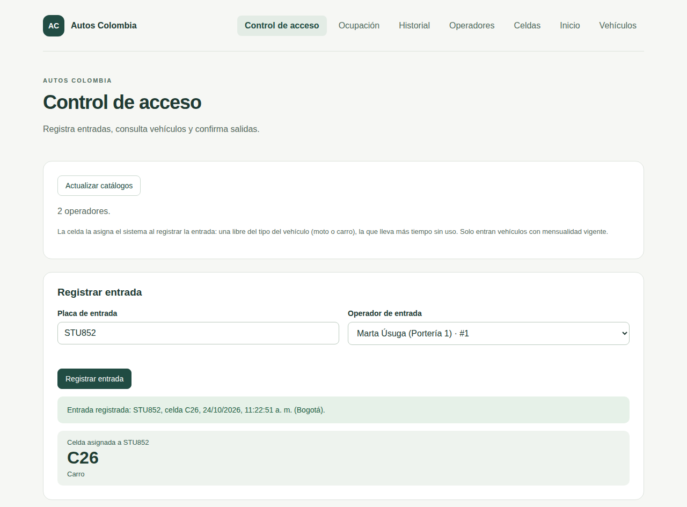
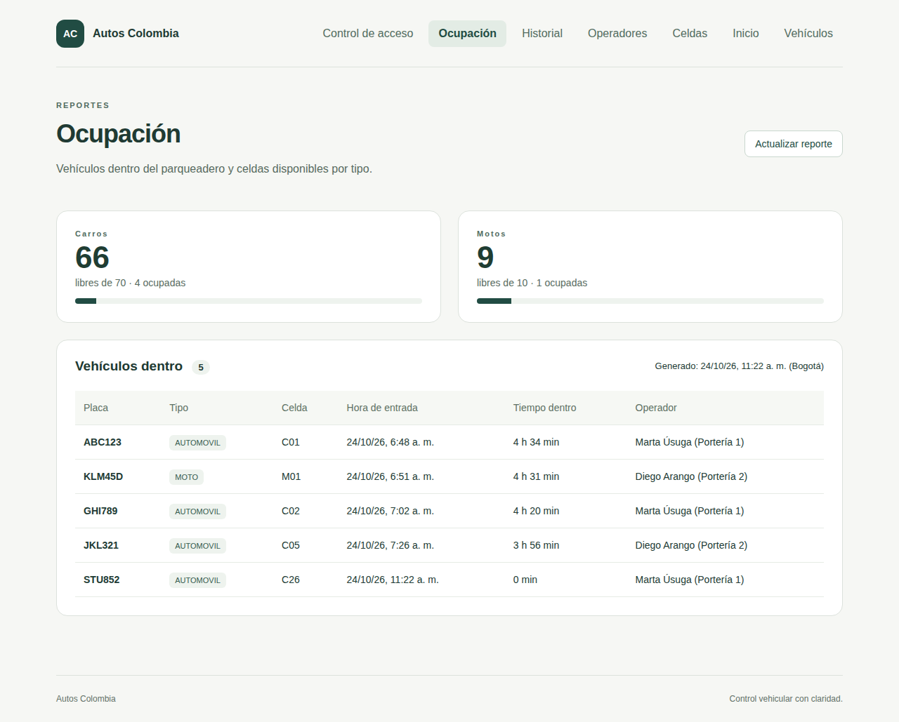
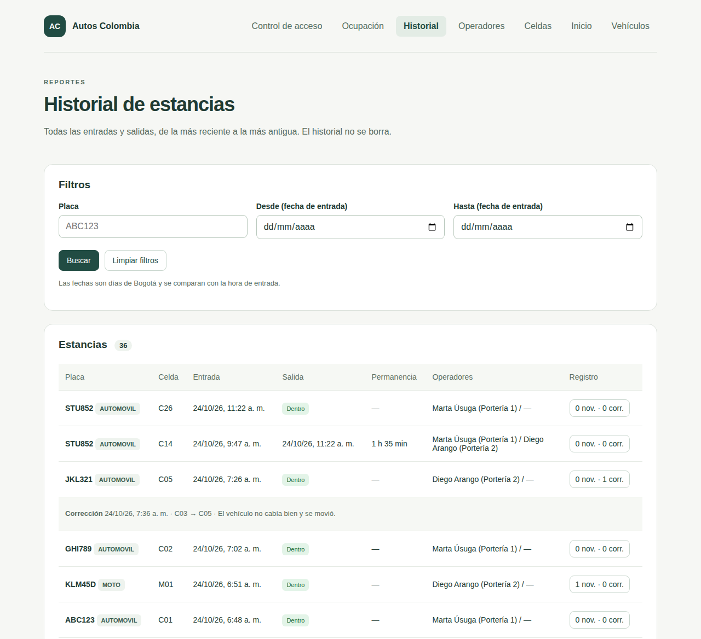
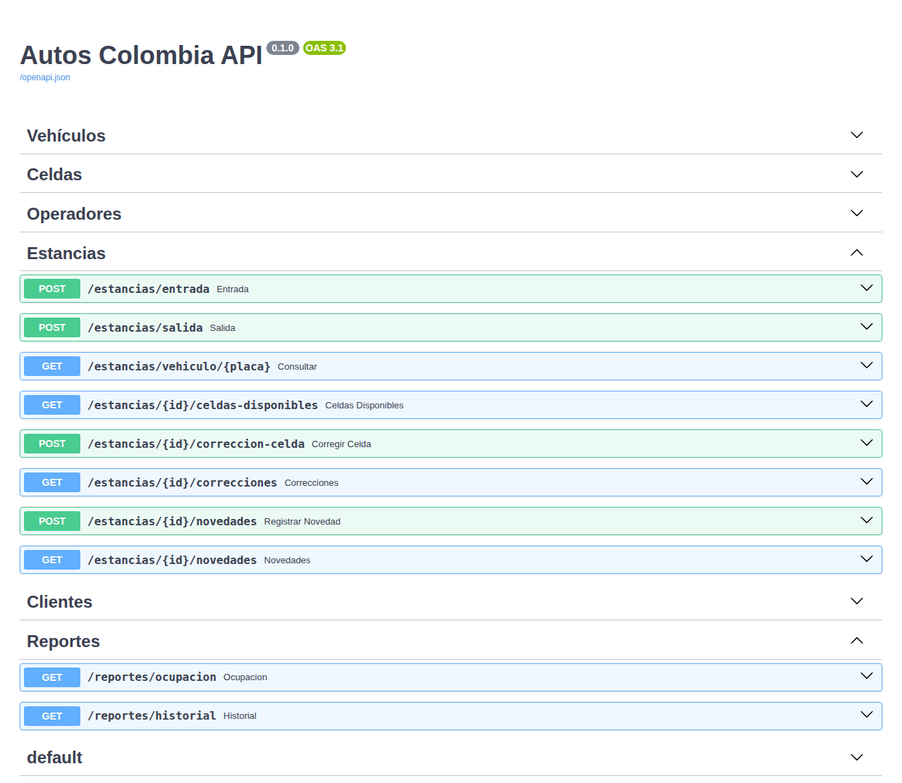

# Autos Colombia — EA1, Iteración 1: entrada y salida de vehículos

Proyecto del curso **Ingeniería de Software (IU Digital)**. Sistema para el parqueadero
"Autos Colombia": clientes con mensualidad por vehículo, entrada con asignación automática
de celda, salida con tiempo de permanencia, corrección de celda, novedades, reporte de
ocupación e historial.

- **Backend:** Python 3.12 · FastAPI · SQLAlchemy · Alembic · PostgreSQL 17.
- **Frontend:** Angular 22 · TypeScript, servido por nginx.
- **Todo se levanta con un solo comando** usando Docker Compose.

> **Basado en el proyecto del profesor Reinaldo Rojas**
> (<https://github.com/ReinaldoRojas/AutosColombia>). Ver [Crédito](#crédito-qué-viene-del-profesor-y-qué-agregamos).

## Contenido

1. [Inicio rápido](#inicio-rápido)
2. [Capturas](#capturas)
3. [Guion de demostración (HU-01 a HU-14)](#guion-de-demostración-hu-01-a-hu-14)
4. [Verificación de requerimientos no funcionales](#verificación-de-requerimientos-no-funcionales)
5. [Reglas implementadas](#reglas-implementadas)
6. [API](#api)
7. [Datos de demostración](#datos-de-demostración)
8. [Pruebas](#pruebas)
9. [Arquitectura y estructura](#arquitectura-y-estructura)
10. [Instalación sin Docker](#instalación-sin-docker)
11. [Crédito: qué viene del profesor y qué agregamos](#crédito-qué-viene-del-profesor-y-qué-agregamos)
12. [Decisiones y supuestos](#decisiones-y-supuestos)

## Inicio rápido

Requisitos: Docker 29 y Docker Compose v5 (verificado en Ubuntu con 29.9 / v5.6).

```bash
git clone https://github.com/HannaSalinas/autos-colombia-ea1.git
cd autos-colombia-ea1
cp .env.example .env      # credenciales de PostgreSQL (cambia la contraseña en .env)
docker compose up --build
```

**Antes de levantar el sistema hay que copiar `.env.example` a `.env`.** El usuario y la
contraseña de PostgreSQL no están en el repositorio: Docker Compose los lee de `.env`, que
git ignora. `.env.example` solo trae valores de ejemplo. Si falta `.env`, Compose se detiene
con el mensaje "Falta .env. Ejecuta: cp .env.example .env". Si cambias la contraseña cuando
la base ya existe, recréala con `docker compose down -v`, porque PostgreSQL guarda la
contraseña al crear la base.

Estas direcciones funcionan en tu equipo después de levantar el sistema con `docker compose up`:

| Qué | Dirección |
| --- | --- |
| Aplicación | `http://localhost:4200` |
| Documentación interactiva de la API | `http://localhost:8000/docs` |
| Salud de la API | `http://localhost:8000/health` |

Al arrancar, el backend aplica las migraciones (`alembic upgrade head`) y carga las
**semillas** (`python -m app.seed`): 80 celdas, 2 operadores, 6 clientes, 9 vehículos y sus
mensualidades. Las semillas no se duplican si se reinicia.

```bash
docker compose up --build -d                    # en segundo plano
docker compose logs -f backend                  # registro del backend
docker compose exec backend python -m app.demo  # (opcional) historial de 7 días para capturas
docker compose down                             # detener (conserva los datos)
docker compose down -v                          # detener y BORRAR la base (vuelve a quedar limpia al levantar)
```

## Capturas

Tomadas del sistema con los [datos de demostración](#datos-de-demostración) cargados. Todos
los nombres, placas y documentos son ficticios.

**Control de acceso:** entrada registrada con la celda que asignó el sistema.



**Ocupación:** celdas libres por tipo y vehículos dentro.



**Historial:** estancias con permanencia, operadores y el detalle de novedades y correcciones.



**Documentación de la API** (`/docs`, generada por FastAPI).



## Guion de demostración (HU-01 a HU-14)

Empieza con la **base limpia** (solo semillas), para que las celdas asignadas coincidan
con las de este guion:

```bash
docker compose down -v && docker compose up --build -d
```

Los dos operadores son **Marta Úsuga (Portería 1)** y **Diego Arango (Portería 2)**.
Las fechas se muestran en hora de Bogotá y las asigna el servidor. Los pasos siguen el
orden de una demostración real: primero se registra un vehículo, luego entra, se consulta,
se corrige y sale. Cada paso lleva el número de su historia de usuario. Los requerimientos
no funcionales se verifican al final, en
[Verificación de requerimientos no funcionales](#verificación-de-requerimientos-no-funcionales).

### HU-14 · Registrar vehículo con propietario

1. En **Vehículos → Nuevo vehículo** registra: placa `qwe-456`, marca Kia, modelo 2024,
   color Gris, tipo AUTOMOVIL y cliente **Paola Ríos**. Se guarda como `QWE456`.
2. Sin cliente no deja guardar ("Selecciona el cliente").
3. El selector de tipo solo ofrece MOTO, AUTOMOVIL y CAMIONETA. En `/docs`,
   `POST /vehiculos` con `"tipo": "CAMION"` responde **422**.
4. Modelo `1899` o el año actual + 2: error de año. El rango válido va de 1900 al año
   actual + 1.
5. En `/docs`, `GET /clientes` y luego `GET /clientes/{id}/vehiculos` de Paola Ríos: ahora
   tiene dos vehículos (MNO654 y QWE456). Un cliente puede tener varios vehículos.

### HU-03 · Validar formato de placa

En **Vehículos → Nuevo vehículo**:

| Datos | Resultado |
| --- | --- |
| Placa `ABC12D`, tipo AUTOMOVIL | Error: la placa de carro es 3 letras y 3 números |
| Placa `ZZZ111`, tipo MOTO | Error: la placa de moto es 3 letras, 2 números y 1 letra |
| Placa ` xyz-98 a `, tipo MOTO, modelo del año actual + 1 | Se guarda como `XYZ98A` |

La misma regla se valida en el navegador, en la API (422) y en PostgreSQL (CHECK). En
Control de acceso la placa también se normaliza: `abc-123` se busca como `ABC123` (se ve
en HU-02).

### HU-01 · Identificar operador

1. Abre **Control de acceso**. El panel de catálogos muestra "2 operadores".
2. En **Registrar entrada**, escribe `ABC123` y pulsa *Registrar entrada* sin elegir
   operador: no se envía y aparece "Selecciona un operador.". La salida, la corrección y la
   novedad también exigen operador.
3. En `/docs`, `POST /estancias/entrada` con `"operador_id": 999` responde **404**
   "Operador no encontrado.".
4. Cada movimiento guarda quién lo hizo. Se ve en Ocupación (HU-12) y en el Historial
   (HU-13).

### HU-04 · Validar vehículo registrado y mensualidad vigente

1. En **Vehículos**, la columna *Mensualidad* muestra cada caso:
   - ABC123: "Vigente hasta …".
   - GHI789: vigente hasta **hoy** (vence hoy y todavía puede entrar).
   - DEF456: "Vencida el …".
   - PQR98B: "Empieza el …" (mañana).
   - MNO654: "Sin mensualidad".
2. En **Control de acceso → Registrar entrada**, con Marta Úsuga:
   - `AAA111` (no está registrado): "Vehículo no encontrado.".
   - `DEF456`, `PQR98B` y `MNO654`: "El vehículo no tiene mensualidad vigente. No puede
     ingresar.".
3. Fecha a fecha: en `/docs`, `GET /vehiculos/6/mensualidades` (JKL321) muestra una
   renovación en la que cada periodo termina el mismo día del mes siguiente. Los casos de
   31 de enero → 28/29 de febrero están en `tests/test_reglas.py`.

### HU-02 · Registrar entrada

En **Control de acceso → Registrar entrada** (no hay selector de celda), con Marta Úsuga,
escribe `abc-123` y pulsa *Registrar entrada*. Aparece "Entrada registrada: ABC123, celda
**C01**, …" con la hora del servidor, y una tarjeta con la celda asignada.

### HU-05 · Evitar doble entrada

Vuelve a registrar la entrada de `ABC123`: responde "El vehículo ya está dentro.". Además
de esta validación, la base tiene un índice único que no permite dos estancias abiertas del
mismo vehículo.

### HU-06 · Asignar celda automáticamente

1. Con Marta Úsuga registra las entradas:

   | Placa | Celda asignada |
   | --- | --- |
   | `KLM45D` | **M01** (moto → celda de moto) |
   | `GHI789` | **C02** (carro; su mensualidad vence hoy y todavía entra) |

   Regla: celda libre del tipo del vehículo; primero las nunca usadas y luego la que lleva
   **más tiempo libre**. Esto se comprueba en HU-08.
2. **Dos porterías al mismo tiempo:** abre Control de acceso en **dos ventanas**, una con
   Marta (Portería 1) y otra con Diego (Portería 2). Escribe `JKL321` en las dos y pulsa
   *Registrar entrada* en ambas. Una registra la entrada (celda **C03**) y la otra responde
   "El vehículo ya está dentro.". Nunca se repite celda ni se abren dos entradas.
3. **No hay celdas:** cuando no queda ninguna libre del tipo, la entrada responde "No hay
   celdas disponibles para motos." (o "para carros."). Llenar 70 celdas a mano no es práctico
   en una demostración, así que se prueba con
   `test_concurrencia_una_sola_celda_libre`: dos motos piden la única celda libre a la vez,
   una la recibe y la otra recibe ese mensaje (ver RNF-03).

### HU-11 · Consultar estado de un vehículo

En **Control de acceso → Consultar vehículo**:

| Placa | Resultado |
| --- | --- |
| `ABC123` | "ABC123 · Dentro", marca y color, "Celda C01 · Entrada …" y el botón *Confirmar salida* |
| `DEF456` | "DEF456 · Fuera" |
| `AAA111` | "Vehículo no registrado." |

La mensualidad de cada vehículo se consulta en **Vehículos** (HU-04).

### HU-07 · Registrar salida con tiempo de permanencia

Con `ABC123` consultado, elige a **Diego Arango** como operador y pulsa **Confirmar
salida**. Se muestra en grande el **tiempo de permanencia** (por ejemplo "4 min"), que
calcula el servidor con sus propias horas de entrada y salida.

### HU-08 · Liberar celda

1. Consulta otra vez `ABC123`: ahora aparece "Fuera". En **Ocupación**, C01 ya no está
   ocupada.
2. Registra la entrada de `STU852`. Recibe **C04**, que nunca se ha usado, y no C01, que
   acaba de quedar libre: así se reparte el uso de las celdas.

### HU-09 · Corregir celda

1. Consulta `GHI789` (está en C02). Debajo aparece **Corregir celda**, que solo lista celdas
   libres de carro.
2. Pulsa *Corregir celda* sin motivo: lo pide.
3. Elige **C10**, escribe el motivo "El conductor parqueó en la C10" y pulsa *Corregir celda*.
   La consulta pasa a "Celda C10" y la corrección queda listada (C02 → C10) con fecha y motivo.
4. En `/docs`, `POST /estancias/{id}/correccion-celda` hacia una celda de moto o hacia una
   ocupada responde **409** con el motivo.

### HU-10 · Registrar novedad

Con GHI789 consultado, en **Novedades del vehículo** elige *Rayón*, escribe "Rayón en el
bómper trasero" y pulsa *Registrar novedad*. Aparece en la lista con fecha y hora.

### HU-12 · Ver reporte de ocupación

**Ocupación** muestra 4 vehículos dentro (KLM45D en M01, GHI789 en C10, JKL321 en C03 y
STU852 en C04) con hora de entrada, tiempo dentro y operador. Arriba aparecen **67 libres
de 70** carros y **9 libres de 10** motos.

### HU-13 · Consultar historial

1. **Historial** muestra todas las estancias, de la más reciente a la más antigua, con
   operador de entrada y de salida.
2. Filtra por placa `abc-123`: aparece la estancia cerrada de ABC123 con su permanencia.
3. Filtra por *Desde* y *Hasta* = hoy: aparecen las estancias de hoy. Si *Desde* es
   posterior a *Hasta*, no deja buscar.
4. En la fila de GHI789 pulsa el botón "1 nov. · 1 corr.": muestra la corrección C02 → C10
   y la novedad.

Para capturas con más datos, ver [Datos de demostración](#datos-de-demostración).

## Verificación de requerimientos no funcionales

### RNF-03 · Concurrencia

Además de la prueba con dos ventanas (HU-06), hay pruebas que obligan a dos porterías a
enviar la solicitud exactamente a la vez:

- mismo vehículo: una entrada y un "ya está dentro";
- dos vehículos: reciben celdas distintas;
- una sola celda libre: uno la recibe y el otro recibe "No hay celdas disponibles";
- dos salidas del mismo vehículo: solo una se registra;
- dos correcciones hacia la misma celda: solo una se aplica.

```bash
docker compose run --rm --build backend-tests sh -c \
  "python -m alembic -c alembic.ini upgrade head && python -m pytest -v tests/test_estancias_postgres.py"
```

Cómo se logra: `SELECT … FOR UPDATE SKIP LOCKED` al elegir la celda, `FOR UPDATE` sobre la
estancia al salir o corregir, y los índices únicos parciales como última barrera.

### RNF-04 · Trazabilidad

1. En **Historial**, cada estancia muestra el operador de entrada y el de salida, y las
   horas asignadas por el servidor (en hora de Bogotá). Las correcciones y novedades
   también guardan operador, hora y motivo o descripción.
2. **El historial no se borra.** En **Vehículos** intenta eliminar ABC123: se rechaza
   porque tiene registros relacionados. La API no tiene ninguna operación para borrar
   estancias, correcciones ni novedades.

### RNF-05 · Integridad

La base de datos protege las reglas aunque alguien se salte la aplicación. Estas órdenes
se ejecutan directo en PostgreSQL y **todas fallan**, así que no cambian nada:

```bash
docker compose exec db psql -c "UPDATE vehiculo SET placa = 'ABC-123' WHERE placa = 'ABC123';"
# ERROR: … violates check constraint "ck_vehiculo_placa_formato"
docker compose exec db psql -c "DELETE FROM vehiculo WHERE placa = 'ABC123';"
# ERROR: … violates foreign key constraint "fk_estancia_vehiculo" …
docker compose exec db psql -c "INSERT INTO estancia (vehiculo_id, celda_id, operador_entrada_id) SELECT vehiculo_id, 50, 1 FROM estancia WHERE salida IS NULL LIMIT 1;"
# ERROR: duplicate key value violates unique constraint "uq_estancia_vehiculo_abierta"
```

Todas las llaves, restricciones e índices están en [`docs/modelo_fisico.sql`](docs/modelo_fisico.sql)
(esquema exportado con `pg_dump`) y explicados en
[`docs/diccionario_datos.md`](docs/diccionario_datos.md).

### RNF-06 · Credenciales fuera del repositorio

1. El usuario y la contraseña de PostgreSQL están solo en `.env`, que git ignora (`.gitignore`).
   El repositorio trae `.env.example` con valores de ejemplo, y `docker-compose.yml` solo
   tiene referencias `${POSTGRES_USER}` y `${POSTGRES_PASSWORD}`.
2. Para comprobar que ningún archivo versionado tiene la contraseña ni el archivo `.env`:

   ```bash
   git check-ignore .env                                    # imprime ".env": está ignorado
   git ls-files | grep -E '(^|/)\.env$'                     # vacío: .env no está versionado
   git grep -n "$(grep '^POSTGRES_PASSWORD=' .env | cut -d= -f2)"   # vacío: la contraseña real no aparece
   ```

3. Sin `.env` el sistema no arranca: Compose avisa que hay que copiar `.env.example`.
4. El backend tampoco guarda credenciales en el código: las lee de variables de entorno o de
   `backend/.env` (también ignorado) y no las muestra en los errores.

### RNF-07 · Portabilidad

1. Todo se levanta en cualquier equipo con Docker usando un solo comando:
   `docker compose up --build` (ver [Inicio rápido](#inicio-rápido)). Se verificó clonando
   el repositorio desde cero en otra carpeta.
2. Sin Docker: ver [Instalación sin Docker](#instalación-sin-docker) (Linux, Python 3.12,
   Node 22 y PostgreSQL 17).
3. La configuración va en variables de entorno (`DB_*`), no en el código.

### RNF-09 · Calidad

1. Pruebas automáticas (ver [Pruebas](#pruebas)): **244 de backend** (unitarias, valores
   límite, integración con PostgreSQL real y concurrencia) y **58 de frontend**:

   ```bash
   docker compose run --rm --build backend-tests
   cd frontend && npm ci && npm test -- --watch=false
   ```

2. Arquitectura por capas: las reglas de negocio están en `app/domain/reglas.py`, sin
   base de datos, y se prueban solas (ver [Arquitectura](#arquitectura-y-estructura)).
3. Cada cambio de esquema es una migración Alembic nueva, y una prueba comprueba que las
   migraciones coinciden con los modelos.

## Reglas implementadas

| Regla | Dónde se aplica |
| --- | --- |
| Placa sin espacios ni guiones y en mayúsculas (`abc-123` → `ABC123`) | `app/domain/reglas.py`, pantallas |
| Placa de carro `ABC123`; de moto `ABC12D` | Dominio, API (422), CHECK en PostgreSQL y pantalla |
| Modelo entre 1900 y el año actual + 1 (fecha de Bogotá) | Dominio, API (422), CHECK `>= 1900` y pantalla |
| Todo vehículo pertenece a un cliente; un cliente puede tener varios | FK `vehiculo.cliente_id` NOT NULL |
| No se puede cambiar el tipo de un vehículo que está dentro | Servicio de vehículos (409) |
| Mensualidad **por vehículo**, de fecha a fecha (31-ene → 28/29-feb); vigente si inicio ≤ hoy ≤ fin | Dominio y servicio de mensualidades |
| Solo entran vehículos con mensualidad vigente | Servicio de estancias (409) |
| 80 celdas: C01–C70 de carro y M01–M10 de moto; automóvil y camioneta usan celda de carro | Semillas, CHECK `tipo IN ('MOTO','CARRO')` |
| El sistema asigna la celda: libre, del tipo correcto y la que lleva más tiempo libre (las nunca usadas primero) | `orden_de_asignacion` en el dominio y `ORDER BY disponible_desde NULLS FIRST, codigo` |
| Dos porterías a la vez nunca reciben la misma celda ni abren dos entradas del mismo vehículo | `SELECT … FOR UPDATE SKIP LOCKED` + índices únicos parciales del profesor |
| La celda queda ocupada hasta la salida; al salir se libera y se muestra la permanencia | Servicio de estancias (`disponible_desde`, `permanencia`) |
| Corregir la celda de una estancia **abierta**, solo hacia una celda **libre y compatible**, con **motivo obligatorio** (máx. 200 caracteres) | Servicio de estancias (409/422), tabla `correccion_celda` |
| Novedades del vehículo (rayón, golpe, objeto olvidado, otro) en su estancia abierta | Tabla `novedad`; se consultan también después de la salida |
| No se cambia el tipo de una celda ocupada | Servicio de celdas (409) |
| Reporte de ocupación: vehículos dentro y celdas libres por tipo | `GET /reportes/ocupacion`, pantalla Ocupación |
| Historial filtrable por placa y por días de Bogotá (sobre la hora de entrada) | `rango_bogota` en el dominio, `GET /reportes/historial`, pantalla Historial |
| Cada movimiento guarda hora del servidor (UTC) y operador; se muestra en America/Bogota | Servicios y pantallas |
| El historial no se borra | Sin endpoints de borrado de movimientos; FK `ON DELETE RESTRICT` |

## API

Documentación interactiva completa en `http://localhost:8000/docs` (con el sistema
levantado). Rutas del profesor (CRUD de `/vehiculos`, `/celdas` y `/operadores`, `/health`)
y rutas agregadas o cambiadas:

| Método y ruta | Descripción |
| --- | --- |
| `GET /clientes`, `GET /clientes/{id}`, `GET /clientes/{id}/vehiculos` | Clientes (solo lectura) y sus vehículos con estado de mensualidad |
| `GET /vehiculos/{id}/mensualidades` | Mensualidades del vehículo y si cada una está vigente |
| `POST /estancias/entrada` | **Cambió:** recibe solo `placa` y `operador_id`; responde con la celda asignada |
| `POST /estancias/salida` | Responde además con `duracion_segundos` y `permanencia` ("2 h 15 min") |
| `GET /estancias/vehiculo/{placa}` | (Profesor) estado del vehículo: dentro o fuera y su celda |
| `GET /estancias/{id}/celdas-disponibles` | Celdas libres y compatibles para corregir |
| `POST /estancias/{id}/correccion-celda` | `celda_id`, `operador_id`, `motivo` → 201 |
| `GET /estancias/{id}/correcciones` | Correcciones de la estancia |
| `POST /estancias/{id}/novedades`, `GET /estancias/{id}/novedades` | `tipo` (`RAYON`, `GOLPE`, `OBJETO_OLVIDADO`, `OTRO`), `descripcion`, `operador_id` |
| `GET /reportes/ocupacion` | Celdas por tipo (total, ocupadas, libres) y vehículos dentro |
| `GET /reportes/historial?placa&desde&hasta&offset&limit` | Historial paginado; `desde`/`hasta` son días `AAAA-MM-DD` de Bogotá, incluidos |

Las respuestas de `/vehiculos` incluyen `cliente_id`, `cliente_nombre`,
`mensualidad_vigente`, `mensualidad_hasta` y `mensualidad_proxima`.

Códigos de error: **404** (referencia inexistente), **409** (conflicto con el estado:
vehículo ya dentro, sin mensualidad vigente, sin celdas libres, celda ocupada o
incompatible, estancia cerrada, cambio de tipo no permitido), **422** (datos inválidos) y
**503** (fallo de base de datos, con mensaje genérico).

## Datos de demostración

### Semillas (se cargan siempre al arrancar)

`backend/app/seed.py` crea las 80 celdas, los operadores "Marta Úsuga (Portería 1)" y
"Diego Arango (Portería 2)" y estos vehículos ficticios. Las fechas de las mensualidades se
calculan a partir de **hoy**, para que la demostración siempre tenga todos los casos:

| Placa | Tipo | Cliente | Mensualidad |
| --- | --- | --- | --- |
| ABC123 | Automóvil | Laura Gómez | Vigente |
| KLM45D | Moto | Laura Gómez | Vigente |
| DEF456 | Camioneta | Carlos Pérez | Vencida hace 5 días |
| GHI789 | Automóvil | Ana Restrepo | Vence hoy (todavía puede entrar) |
| XYZ12A | Moto | Ana Restrepo | Vencida |
| JKL321 | Automóvil | Jorge Mesa | Renovada (dos periodos seguidos) |
| MNO654 | Camioneta | Paola Ríos | Nunca ha pagado |
| PQR98B | Moto | Andrés Cano | Empieza mañana (hoy no está vigente) |
| STU852 | Automóvil | Andrés Cano | Vigente |

### Historial de 7 días para capturas (opcional, NO se ejecuta al arrancar)

`backend/app/demo.py` crea estancias cerradas de los últimos 7 días y 5 vehículos dentro
(ABC123, KLM45D, GHI789, JKL321 y STU852):

- varias estancias por placa;
- solo en días en que el vehículo tenía mensualidad vigente;
- con correcciones y novedades;
- nunca dos vehículos en la misma celda al mismo tiempo.

Solo corre sobre una base **sin estancias**:

```bash
docker compose exec backend python -m app.demo       # con Docker
backend/.venv/bin/python -m app.demo                 # sin Docker (después de app.seed)
```

Para **volver a la base limpia** (solo semillas):

```bash
docker compose down -v && docker compose up -d
```

> Con los datos de demostración cargados, los 5 vehículos con mensualidad vigente ya están
> dentro. Para seguir el guion de arriba, usa la base limpia.

## Pruebas

```bash
docker compose run --rm --build backend-tests   # backend: unitarias + integración con PostgreSQL real
docker compose --profile test rm -sf db-test    # quita solo la base de pruebas (la de la app no se toca)
cd frontend && npm ci && npm test -- --watch=false   # frontend (Vitest); requiere Node 22
```

`backend-tests` usa un PostgreSQL **aparte** (`db-test`, en memoria): las pruebas nunca
tocan los datos de la demostración. Resultado al cerrar la iteración: **244 pruebas de
backend** y **58 de frontend** aprobadas.

| Tipo | Archivos | Qué comprueban |
| --- | --- | --- |
| Unitarias de reglas y valores límite | `tests/test_reglas.py` | Placa (formatos, normalización), modelo (1899/1900, año + 1/+ 2), mensualidad fecha a fecha (fin de mes, bisiesto, día anterior/inicio/fin/día siguiente), tipo de celda, orden de asignación, permanencia, rango de días de Bogotá (00:00 y 23:59:59) |
| Integración de endpoints | `tests/test_*_postgres.py`, `test_estancias_api.py` | Cada endpoint con PostgreSQL real, sus errores 404/409/422 y las restricciones de la base, dentro de transacciones que se revierten |
| Concurrencia | `tests/test_estancias_postgres.py` | Dos porterías a la vez: mismo vehículo, dos vehículos, una sola celda libre, dos salidas y dos correcciones hacia la misma celda |
| Esquema | `tests/test_models.py`, `test_estancia.py`, `test_esquema_postgres.py` | Migraciones iguales a los modelos y SQL de cada migración |
| Datos | `tests/test_seed_postgres.py`, `test_demo_postgres.py` | Semillas sin duplicados; datos de demostración que respetan las reglas |
| Frontend | `src/app/**/*.spec.ts` | Formularios, validaciones, llamadas HTTP y mensajes de cada pantalla |

## Arquitectura y estructura

Arquitectura por capas, igual que el proyecto base:

```text
Presentación   frontend/src/app/*            Angular: pantallas, formularios, llamadas HTTP
               backend/app/routers/*         FastAPI: rutas, sin lógica de negocio
Dominio        backend/app/domain/reglas.py  Reglas puras (sin BD): placa, modelo, mensualidad,
                                             tipo de celda, orden de asignación, permanencia, fechas
Servicios      backend/app/services/*        Casos de uso: transacciones, bloqueos, errores públicos
Persistencia   backend/app/models.py         SQLAlchemy + restricciones; migraciones Alembic 0001–0005
```

```text
AutosColombia/
├── docker-compose.yml          # (nuestro) db, backend, frontend, db-test, backend-tests
├── .env.example                # (nuestro) plantilla de credenciales: cp .env.example .env
├── AGENTS.md                   # (profesor) guía original para Windows
├── docs/README-profesor.md     # (profesor) README original sin cambios
├── docs/modelo_fisico.sql      # (nuestro) esquema real exportado con pg_dump
├── docs/diccionario_datos.md   # (nuestro) tablas, columnas, tipos, llaves y restricciones
├── backend/
│   ├── Dockerfile              # (nuestro) migra, carga semillas e inicia la API
│   ├── app/
│   │   ├── domain/reglas.py    # (nuestro) reglas de negocio puras
│   │   ├── models.py           # (profesor + nuestro) Cliente, Mensualidad, CorreccionCelda, Novedad
│   │   ├── schemas/ services/ routers/
│   │   ├── seed.py             # (nuestro) semillas
│   │   └── demo.py             # (nuestro) datos de demostración opcionales
│   ├── migrations/versions/    # 0001–0002 del profesor; 0003–0005 nuestras
│   └── tests/
└── frontend/
    ├── Dockerfile              # (nuestro) compila Angular y lo sirve con nginx
    ├── nginx/default.conf      # (nuestro) proxy de la API dentro de Docker
    └── src/app/                # control-acceso, estancia-acciones, ocupacion, historial, vehiculos, celdas, …
```

Nginx hace dentro de Docker lo mismo que `frontend/proxy.conf.json` en desarrollo: el
navegador llama a `/vehiculos`, `/estancias`, `/reportes`, etc. en el mismo origen y nginx
lo reenvía al backend, así que no hace falta CORS. Las pantallas usan rutas `/gestion/…` y
`/consultas/…` para no chocar con las rutas de la API.

### Migraciones

| Revisión | Autor | Cambio |
| --- | --- | --- |
| 0001 | Profesor | `vehiculo`, `celda`, `operador` |
| 0002 | Profesor | `estancia` con índices únicos de estancias abiertas |
| 0003 | Nuestra | `cliente`, `mensualidad`, `vehiculo.cliente_id`, CHECK de placa según tipo y modelo ≥ 1900 |
| 0004 | Nuestra | `celda.tipo` MOTO o CARRO (`NOT VALID`) y `celda.disponible_desde` |
| 0005 | Nuestra | `correccion_celda` y `novedad` |

No se modificó ninguna migración existente. El esquema resultante está en
[`docs/modelo_fisico.sql`](docs/modelo_fisico.sql) y su diccionario de datos en
[`docs/diccionario_datos.md`](docs/diccionario_datos.md).

## Instalación sin Docker

Verificado con Python 3.12.3 y Node 22.23.3 / npm 10.9.9. El proyecto del profesor indica
Python 3.13 y Node 24. Comprobamos que también funciona con Python 3.12 (todas las
dependencias se instalan y pasan las pruebas) y con Node 22 (Angular 22 acepta
`^22.22.3 || ^24.15.0`).

Necesitas un PostgreSQL. Lo más sencillo es levantar solo el de Docker con
`docker compose up -d db`.

### Backend

```bash
cd backend
python3 -m venv .venv
.venv/bin/python -m pip install -r requirements.txt
cp -n .env.example .env        # edita DB_NAME, DB_USER y DB_PASSWORD
.venv/bin/python check_db.py   # comprueba la conexión (SELECT 1)
.venv/bin/python -m alembic -c alembic.ini upgrade head
.venv/bin/python -m app.seed
.venv/bin/python -m uvicorn app.main:app --reload --host 127.0.0.1 --port 8000
```

Con el PostgreSQL de Docker, `backend/.env` lleva `DB_NAME=autos_colombia` y, en `DB_USER` y
`DB_PASSWORD`, los mismos valores de `POSTGRES_USER` y `POSTGRES_PASSWORD` del `.env` de la
raíz. Ninguno de los dos `.env` se sube a git.

```bash
.venv/bin/python -m pytest -q                      # sin PostgreSQL (se omiten las de integración)
RUN_POSTGRES_TESTS=1 .venv/bin/python -m pytest -q # con PostgreSQL real
```

Con `RUN_POSTGRES_TESTS=1`, las pruebas escriben y limpian sus propios registros en la
base de `.env`. Las de concurrencia se omiten solas si la base ya tiene celdas, porque
la asignación elige entre todas las libres. Por eso conviene usar `backend-tests` de Docker.

### Frontend

```bash
cd frontend
npm ci
npm start -- --host 127.0.0.1 --port 4200   # http://127.0.0.1:4200 (con el backend iniciado)
npm test -- --watch=false
npm run build
```

## Crédito: qué viene del profesor y qué agregamos

Este proyecto **parte de la solución base publicada por el profesor Reinaldo Rojas** en
<https://github.com/ReinaldoRojas/AutosColombia>. Conservamos su historial de git (los dos
primeros commits son suyos) y su código. Su README original, escrito para
Windows/PowerShell, está **sin cambios** en [docs/README-profesor.md](docs/README-profesor.md),
y su guía `AGENTS.md` también se conserva.

| Origen | Contenido |
| --- | --- |
| **Profesor** | Estructura por capas (routers, schemas, services, models), configuración y conexión a PostgreSQL, modelos `Vehiculo`, `Celda`, `Operador` y `Estancia`, migraciones `0001` y `0002` (con los índices únicos de estancias abiertas), CRUD de vehículos, celdas y operadores, entrada, salida y consulta de estancias, pantallas Angular (Inicio, Vehículos, Celdas, Operadores, Control de acceso) y sus pruebas, incluida la técnica de pruebas de concurrencia con barreras. |
| **Nuestro** · Fase 0 | Adaptación a Linux, Dockerfiles, nginx, `docker-compose.yml` con base de pruebas desechable y este README. |
| **Nuestro** · Fase 1 | Capa de dominio, `Cliente` y `Mensualidad` (migración 0003), cliente obligatorio, validaciones de placa y modelo, API de clientes y mensualidades, semillas, selector de cliente y estado de mensualidad en Vehículos. |
| **Nuestro** · Fase 2 | Celdas MOTO o CARRO con `disponible_desde` (0004), asignación automática, mensualidad vigente al entrar, permanencia, 80 celdas y 2 operadores, Control de acceso sin selector de celda, pruebas de concurrencia del contrato nuevo. |
| **Nuestro** · Fase 3 | Corrección de celda y novedades (0005), componente `estancia-acciones`, prueba de correcciones simultáneas. |
| **Nuestro** · Fase 4 | Reporte de ocupación, historial filtrable, pantallas Ocupación e Historial, bloqueo del cambio de tipo de una celda ocupada, datos de demostración. |

### Cambios a archivos del profesor

| Archivo | Cambio y motivo |
| --- | --- |
| `README.md` | Se movió **sin cambios** a `docs/README-profesor.md`; este es el README nuevo. |
| `backend/app/models.py` | Modelos `Cliente`, `Mensualidad`, `CorreccionCelda` y `Novedad`. `Vehiculo`: `cliente_id`, CHECK de placa según tipo y modelo ≥ 1900, normalización sin espacios ni guiones (el mínimo del modelo pasó de 1 a 1900). `Celda`: tipo MOTO o CARRO y `disponible_desde`. |
| `backend/app/schemas/vehiculo.py` | `cliente_id` obligatorio, placa según tipo, modelo 1900 … año actual + 1; respuesta `VehiculoDetalle`. |
| `backend/app/schemas/celda.py` | El tipo pasó de texto libre a MOTO o CARRO; la respuesta no revalida (pueden existir celdas antiguas). |
| `backend/app/schemas/estancia.py` | Entrada sin `celda_id`; respuestas con celda y permanencia; corrección y novedad. `Identificador` se movió a `schemas/comun.py`. |
| `backend/app/services/vehiculo.py` | Cliente existente, placa válida con el tipo final en PATCH, bloqueo del cambio de tipo con el vehículo dentro. |
| `backend/app/services/celda.py` | Bloqueo del cambio de tipo de una celda ocupada. |
| `backend/app/services/estancia.py` | Asignación automática con `SKIP LOCKED`, mensualidad vigente, liberación de celda, permanencia, corrección de celda y novedades. |
| `backend/app/routers/vehiculos.py`, `routers/estancias.py`, `main.py` | Rutas nuevas y registro de los routers de clientes y reportes. |
| `backend/tests/test_estancias_postgres.py` | **Reescrita** con la misma técnica (datos confirmados, limpieza por id, barreras) para el contrato nuevo de entrada. |
| `backend/tests/test_vehiculos_postgres.py`, `test_operadores_postgres.py`, `test_celdas_postgres.py`, `test_estancias_api.py`, `test_models.py` | Exigen la revisión más reciente (antes `0001`/`0002`), crean un cliente y placas válidas, usan tipos MOTO o CARRO, entrada sin celda; `test_models.py` excluye de la comparación con `0001` lo agregado por `0003` y `0004`. |
| `frontend/src/app/control-acceso/*` | Sin selector de celda; celda asignada y permanencia; componente de corrección y novedades; etiqueta del operador. |
| `frontend/src/app/vehiculos/*`, `celdas/*` | Selector de cliente, validaciones, columna de mensualidad; tipo de celda MOTO o CARRO. |
| `frontend/src/app/models/*.ts`, `services/estancias.service.ts` | Contratos y llamadas nuevas. |
| `frontend/src/app/app.routes.ts`, `app.html`, `frontend/proxy.conf.json` | Pantallas Ocupación e Historial; rutas `/clientes` y `/reportes` en el proxy. |

## Decisiones y supuestos

- **Fuera de alcance de esta iteración:** login, roles y gestión de usuarios, así como la
  pantalla de gestión de clientes (Iteración 2); pagos y pantalla de mensualidades
  (Iteración 3). El operador se elige en cada formulario, como en el proyecto base.
- **Mensualidad:** por vehículo; vigente si inicio ≤ hoy ≤ fin, con "hoy" en Bogotá. La
  tarifa (carro o moto) no se guarda porque los pagos son de la Iteración 3.
- **Asignación de celda:** entre las celdas libres del tipo correcto, primero las nunca
  usadas y luego la que quedó libre hace más tiempo; si empatan, por código.
- **Concurrencia:** `FOR UPDATE SKIP LOCKED` al elegir la celda, una nueva comprobación con
  el bloqueo tomado, `FOR UPDATE` sobre la estancia al salir o corregir, y los índices únicos
  parciales del profesor como última barrera.
- **Fechas:** se guardan con zona horaria (UTC) y hora del servidor; nunca se aceptan fechas
  del cliente. Se muestran en America/Bogota. El filtro del historial usa días de Bogotá
  sobre la hora de entrada.
- **Credenciales (RNF-06):** el usuario y la contraseña de PostgreSQL van en `.env`, que no
  se versiona, y `.env.example` trae valores de ejemplo. El nombre de la base
  (`autos_colombia`) queda fijo en `docker-compose.yml` porque no es un secreto y las pruebas
  del proyecto base lo exigen. Dentro del contenedor de la base, `PGUSER` y `PGDATABASE`
  permiten usar `psql` y `pg_dump` sin escribir el usuario.
- **Restricciones nuevas sobre tablas existentes:** el tipo de celda usa `NOT VALID` para no
  romper celdas antiguas. La 0003 exige la tabla `vehiculo` vacía porque `cliente_id` es
  obligatorio; si hay vehículos sin dueño, se detiene con un mensaje claro.
- **Numeración HU y RNF:** la del documento de la entrega. El guion sigue el orden lógico
  de la demostración, no el numérico.
